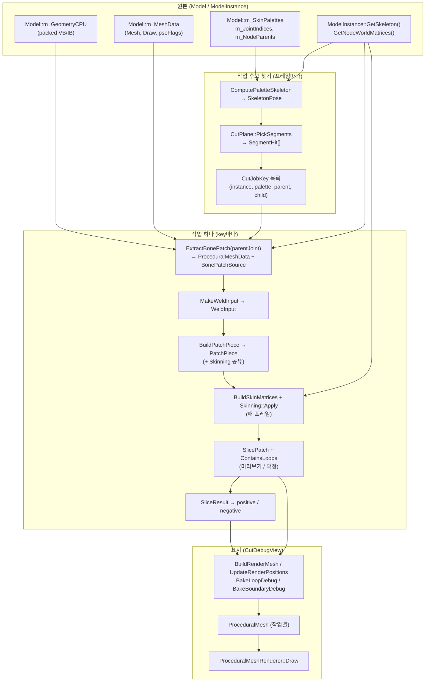
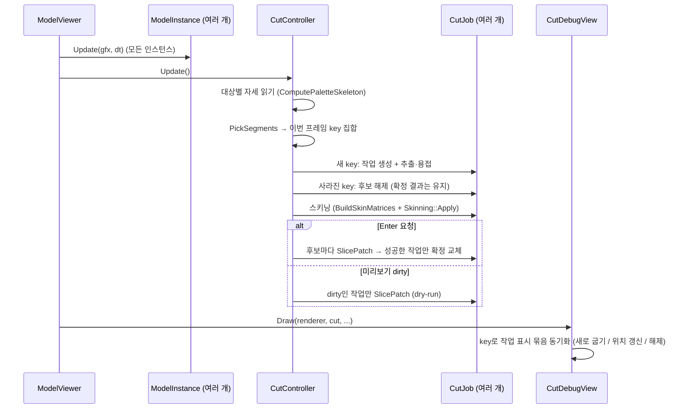
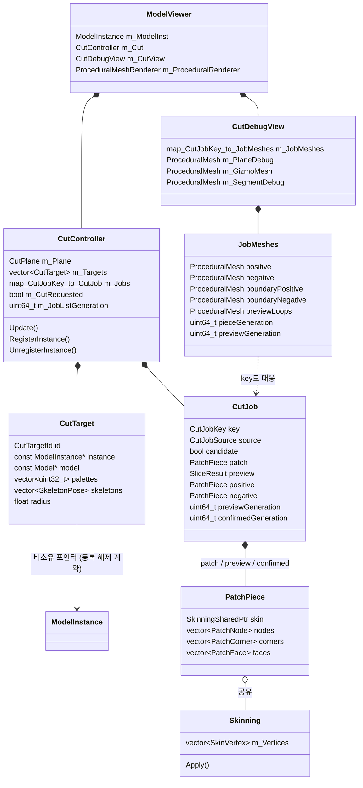
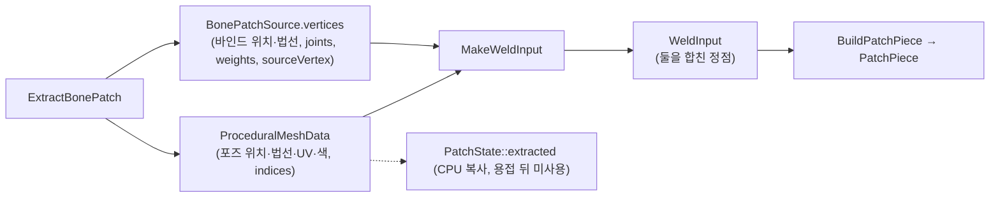

# 선분별·인스턴스별 절단 작업 설계

> 이력 문서: 아래 상태·구현 설명은 과거 CPU 절단 경로의 설계·기록이다. 현재 구현 상태로 해석하지 않는다. 현행 흐름은 [CodeMap.md](../../Current/CodeMap.md), 평면 계약은 [CutPlaneDesign.md](../../Current/CutPlaneDesign.md)를 따른다.

> 작성: 2026-10-21 · 기준: 커밋 `0fc39fe` + 작업 트리(Geometry 통합, CutPlane 클래스, Skinning 클래스까지 반영된 상태)
>
> 상태: **구현** (`b606ba4`). 작업 식별(선분 → 작업)과 추출 기준(부모 joint 하나)은 `JointCutDesign.md`(설계안)로 대체 예정. 근거는 실제 소스의 경로·함수명이다.
>
> 참고: `Docs/NDC/NDC25Reference.md`(원본 기법), `클래스 정리 설계(삭제된 과거 기록)`(클래스 정리 계획), `Docs/NDC/History/PlaneFirstCutDesign.md`(평면 우선 흐름)

## 0. 요약

- **CutController**는 평면 하나, 등록된 대상(모델 인스턴스) 목록, 절단 작업(job) 목록을 소유하고, 프레임마다 "교차 → 작업 목록 갱신 → 스키닝 → 미리보기/확정" 순서를 조율한다.
- **절단 작업 하나 = 독립된 패치 하나.** 작업마다 패치, 출처, 스킨, 미리보기, 확정 결과, 오류를 따로 가진다. 여러 선분의 패치를 합치지 않는다.
- **작업 식별자(key)와 패치 추출 기준을 분리한다.** 스켈레탈 작업의 key는 (인스턴스, 팔레트, 부모 joint, 자식 joint)이고, 추출 기준은 지금처럼 **부모 joint**다.
- **공통 기반은 선분에 종속되지 않는다.** 작업 종류(스켈레탈 선분 / 스태틱 메시)는 "어떤 작업을 만들지"와 "어떤 행렬로 위치를 갱신할지"만 다르고, 용접 → 절단 → 단면 → 렌더 굽기는 같은 파이프라인(`BuildPatchPiece`, `SlicePatch`, `BuildCap`, `BuildRenderMesh`)을 쓴다.
- **스키닝 없는 입력**은 "joint 1개, 가중치 1, 행렬 = 메시 world"인 강체 스킨으로 표현한다. 새 자료형 없이 `Skinning::Apply`를 그대로 쓴다.
- 이번 범위에서 원본 메시 제거·교체, 본 분리·물리, 재절단, 스태틱 메시 구현은 하지 않는다.

## 1. 현재 구조와 요구 구조의 차이

### 1.1 현재 흐름 검증 (실제 코드 기준)

| 알고 있던 내용 | 실제 코드 | 결과 |
| --- | --- | --- |
| CutController가 `CutPlane m_Plane`을 소유 | `Runtime/CutController.h` `CutPlane m_Plane;` | 맞음 |
| `PickSegments`로 교차 선분을 찾음 | `CutController::UpdateCandidate` → `m_Plane.PickSegments(m_Candidate.skeleton, m_Candidate.hits)` | 맞음 |
| `CutJoints`가 부모 joint를 정렬·중복 제거 | `CutPlane::CutJoints(m_Candidate.hits)` | 맞음 |
| joint 집합 전체로 `ExtractBonePatch` 한 번 | `ExtractBonePatch(model, instance, palette, m_Candidate.cutJoints, 0.0f, patch, source)` (BonePatch.cpp 집합 오버로드) | 맞음 |
| `PatchState`, `PreviewState`, `ConfirmedCut` 각 하나 | `m_Patch`, `m_Preview`, `m_Confirmed` (+ `m_Candidate`) | 맞음 |
| `SlicePatch`가 통합 패치 하나를 절단 | `CutController::SliceWithPlane` → `SlicePatch(m_Patch.piece, m_Plane.ToSlicePlane(), 1, ...)` | 맞음. cutId는 항상 1 |
| 확정 결과는 positive/negative 한 쌍 | `ConfirmedCut::positive/negative` | 맞음 |
| Enter는 미절단 후보 패치를 자름 | `ConfirmCut`이 `m_Patch.piece`를 자름. 확정 조각은 입력이 아님 | 맞음 |
| 원본 제거·교체, 물리 미구현 | 해당 코드 없음 | 맞음 |

추가로 확인한 점:
- **인스턴스는 하나만 받는다.** `CutController::Update(const Model&, const ModelInstance&)`와 `ToggleEditPlane(const ModelInstance&, uint32_t paletteId)`가 인스턴스 하나를 인자로 받고, 팔레트도 T를 누를 때 하나(`m_DebugPalette`)로 정해진다(`ModelViewer.cpp` 284행 부근).
- **재추출 방지 기준은 joint 집합 비교다.** `m_Candidate.attemptJoints == cutJoints`면 추출하지 않는다.
- **자세 변화 감지는 패치의 `poseJointWorld` memcmp다.** 바뀌면 `m_Preview.dirty = true` (`CutController::Update`).
- **확정 조각의 스키닝은 확정 당시 출처의 메시 슬롯을 쓴다.** `m_Confirmed.source.meshes`로 `BuildSkinMatrices`를 다시 부르고, 스킨 정점 표는 조각의 `skin`(`shared_ptr<const Skinning>`)이다.
- **추출 결과가 두 번 저장된다.** `PatchState::extracted`(ProceduralMesh, CPU 복사) + `source.vertices`(BonePatchVertex)를 `MakeWeldInput`이 다시 합친다. `extracted`는 용접 입력과 상태 문자열(삼각형 수)에만 쓰인다.
- **표시 메시는 한 쌍뿐이다.** `CutDebugView`가 `m_PiecePositive/Negative`, `m_PreviewLoops` 등 고정 멤버를 갖고, `PieceGeneration()`/`PreviewGeneration()`으로 다시 굽는다.

### 1.2 기존 설계 문서와 다른 점
| 문서 | 문서 내용 | 현재 소스 / 이번 요구 |
| --- | --- | --- |
| `PlaneFirstCutDesign.md` 4절 | "하나의 패치, 한 번의 슬라이스" (절단 joint 집합으로 통합 추출) | 소스는 그대로지만 **이번 요구와 반대**. 이 문서가 대체한다 |
| `PlaneFirstCutDesign.md` 5절 | OpenLoop 시 이웃 joint 합치기(P-3) | 구현 안 됨. 이번 요구(병합 금지)와 맞지 않아 폐기 |
| `클래스 정리 설계(삭제된 과거 기록)` K-3, K-5 | ProceduralMesh가 PatchPiece 위상을 흡수, PatchPiece가 BonePatch 흡수, 이름 `Mesh*` | 미구현. 소스 이름은 `Patch*`(Patch.h). 이 문서는 **현재 이름**을 쓴다 |
| `클래스 정리 설계(삭제된 과거 기록)` K-1, K-2 | CutPlane 클래스, Skinning 클래스 | 소스에 반영됨 (`Geometry/CutPlane.h`, `Geometry/Skinning.h`, `PatchPiece::skin`) |

### 1.3 요구 구조와의 차이

| 항목 | 현재 | 요구 |
| --- | --- | --- |
| 작업 단위 | 교차 joint 집합 전체 = 패치 1개 | 교차 선분 1개 = 작업 1개 |
| 대상 | 인스턴스 1개, 팔레트 1개 | 등록된 인스턴스 여러 개, 각 인스턴스의 스킨 팔레트 전부 |
| 상태 | 패치·미리보기·확정 각 1개 | 작업마다 패치·미리보기·확정·오류 |
| 재추출 방지 | joint 집합 비교 | 작업 key가 이미 있으면 재추출 안 함 |
| Enter | 패치 1개 절단 | 유효한 모든 작업을 각각 절단, 실패는 작업별 |
| 표시 | 고정 멤버 한 쌍 | 작업별 표시 메시 묶음 (key로 동기화, 사라지면 해제) |
| 호출 순서 | `m_ModelInst.Update` 직후 `m_Cut.Update(model, inst)` | 모든 인스턴스 Update 후 `m_Cut.Update()` 한 번 |

## 2. 데이터 흐름

### 2.1 원본 모델에서 작업 결과까지



### 2.2 원본에서 추출되는 정보

| 정보 | 원본 위치 | 저장 위치 (현재) | 쓰는 곳 |
| --- | --- | --- | --- |
| 포즈 위치·법선·UV·색 | `m_GeometryCPU` + 추출 시점 행렬 | `ProceduralMeshData::vertices` | `MakeWeldInput` → 노드 위치, corner 속성 |
| 바인드 위치·바인드 법선 | `m_GeometryCPU` | `BonePatchVertex::position/normal` | 용접 키, `SkinVertex::bindPosition` |
| joint·가중치 | `m_GeometryCPU` | `BonePatchVertex::joints/weights` | 용접 키, 스키닝 |
| 원본 정점 번호 | 원본 VB 인덱스 | `BonePatchVertex::sourceVertex` | (향후) 원본 교체 |
| 원본 삼각형 | (mesh, draw, primitive) | `BonePatchSource::triangles` → `PatchFace::sourceTriangle` | (향후) 원본 숨김 |
| 원본 메시·world 행렬 번호 | `Mesh::meshCBV`, `startJoint` | `BonePatchSource::meshes` | `BuildSkinMatrices` (매 프레임) |
| 추출 시점 joint 행렬 | `GetNodeWorldMatrices` | `BonePatchSource::poseJointWorld` | 자세 변화 감지 |

### 2.3 작업별 변환과 프레임 갱신



## 3. 소유 관계

### 3.1 큰 역할

| 클래스 / 파일 | 책임 | 이번 변경 |
| --- | --- | --- |
| `CutController` (Runtime) | 평면, 대상 목록, 작업 목록의 소유자이자 조율자. 프레임 순서, Enter/Ctrl+Z 정책 | **크게 바뀜** |
| `CutJob` (Runtime, 새 헤더) | 작업 하나의 상태 묶음(데이터만). Model/Core 의존 없음 | **새로** |
| `CutPlane` (Geometry) | 평면 자료, 변환, 선분 교차, 루프 사각형 검사, 기즈모 | 그대로 |
| `BonePatch` | 원본 → 패치 추출, 스킨 행렬, 팔레트 스켈레톤, 용접 입력 변환 | 그대로 (E는 선택 정리) |
| `Patch` (Geometry) | PatchPiece 자료구조, 용접(`BuildPatchPiece`), 검증 | 그대로 |
| `Skinning` (Geometry) | 스킨 정점 표, `Apply` | 그대로 (스태틱은 강체 스킨으로 재사용) |
| `Slice` (Geometry) | `SlicePatch`, 루프, cap | 그대로 |
| `RenderBake` (Rendering) | piece → `ProceduralMeshData`, 디버그 tube | 그대로 |
| `CutDebugView` (Debug) | 작업별 표시 메시와 상태 줄 | **크게 바뀜** |
| `ProceduralMeshRenderer` | GPU 버퍼, mesh 주소 기준 등록 | 그대로 (계약만 지킴) |

### 3.2 소유 관계 다이어그램



### 3.3 ModelInstance 수명 (참조 무효화 방지)

- `ModelInstance`는 참조 카운트가 없고 복사 생성자가 있다(`Model/Model.h`). 그래서 컨트롤러는 **비소유 포인터**만 갖고, 등록·해제를 명시적으로 한다.
  - `CutTargetId RegisterInstance(const ModelInstance& instance, std::wstring name)`
  - `void UnregisterInstance(CutTargetId id)` — 그 대상의 작업을 모두 지운다(확정 결과 포함).
- **계약:** 인스턴스를 파괴·이동·복사로 교체하기 전에 `UnregisterInstance`를 부른다. ModelViewer는 `m_ModelInst`를 멤버로 가지므로 Startup에서 등록, Cleanup에서 해제하면 된다.
- **key에는 포인터가 아니라 `CutTargetId`(등록 순 증가 정수)를 쓴다.** 해제된 주소가 다른 인스턴스에 재사용돼도 옛 작업과 섞이지 않는다.
- **같은 인스턴스가 다른 Model로 바뀌는 경우**(`ModelInstance::operator=(shared_ptr<const Model>)`): 등록 때의 `model` 포인터를 기억하고, `Update`에서 `instance->GetModel()`이 다르면 그 대상의 작업을 모두 지우고 팔레트를 다시 읽는다.
- 같은 Model을 쓰는 서로 다른 인스턴스는 `CutTargetId`가 달라서 key가 다르다. 자세·world 행렬은 항상 각 인스턴스의 `GetSkeleton()`/`GetNodeWorldMatrices()`에서 읽는다(지금 `BuildSkinMatrices`, `ComputePaletteSkeleton`, `ExtractBonePatch`가 이미 instance 인자로 받는다).

### 3.4 표시 메시 주소와 렌더러 계약

- `ProceduralMeshRenderer`는 `std::unordered_map<const ProceduralMesh*, MeshGpu>`로 **메시 주소**를 key로 GPU 버퍼를 기억한다(`ProceduralMeshRenderer.cpp` 182행 `m_Meshes[&mesh]`). 헤더 주석의 계약: "A mesh must outlive Draw calls and must be released before its address is reused."
- `ProceduralMesh`의 버전은 전역에서 유일하다(`ProceduralMesh.cpp` `NextVersion`). 그래서 주소가 재사용돼도 잘못된 버퍼를 그리지는 않는다. 하지만 **해제하지 않은 옛 항목의 GPU 버퍼는 `Shutdown`까지 남는다**(누수).
- 따라서:
  - 작업별 표시 메시는 `std::vector`에 두지 않는다(재할당 때 주소가 바뀐다). `std::map<CutJobKey, JobMeshes>`처럼 노드 기반 컨테이너에 두면 삽입·삭제 때 다른 원소의 주소가 바뀌지 않는다.
  - 작업이 사라지면 `CutDebugView`가 그 `JobMeshes`의 메시마다 `renderer.ReleaseMesh(mesh)`를 부른 뒤 지운다.
  - 컨트롤러의 `CutJob`은 표시 메시를 갖지 않는다(지금처럼 뷰만 GPU를 안다). `CutJob`도 `std::map`에 두어 뷰가 key로 찾는다.

## 4. 핵심 자료형과 함수 시그니처 초안

### 4.1 작업 식별

```cpp
// Runtime/CutJob.h — Model/Core 의존 없음 (단독 테스트 가능)
using CutTargetId = uint32_t;

enum class CutJobKind : uint8_t
{
    SkeletalSegment,    // 스킨 팔레트의 부모 → 자식 선분
    StaticMesh          // 스킨 없는 메시 하나 (이번엔 구조만)
};

// 작업 식별자. 사전식 비교로 std::map의 key가 된다.
struct CutJobKey
{
    CutTargetId target = 0;
    CutJobKind kind = CutJobKind::SkeletalSegment;
    uint32_t a = kNoNode;   // SkeletalSegment: 팔레트, StaticMesh: Model 메시 번호
    uint32_t b = kNoNode;   // SkeletalSegment: 부모 joint, StaticMesh: 미사용
    uint32_t c = kNoNode;   // SkeletalSegment: 자식 joint, StaticMesh: 미사용
    bool operator<(const CutJobKey& other) const;
    bool operator==(const CutJobKey& other) const;
};

static CutJobKey MakeSegmentKey(CutTargetId target, uint32_t palette, uint32_t parentJoint, uint32_t childJoint);
static CutJobKey MakeStaticMeshKey(CutTargetId target, uint32_t meshIndex);
```

- **형제 선분**(같은 부모, 다른 자식)은 `c`가 달라 별개 작업이 된다.
- 필드 이름을 일반적인 `a/b/c`로 둔 이유: 작업 종류마다 key 구조체를 따로 만들지 않기 위해서다. 읽기용으로 `PaletteOf(key)`, `ParentJointOf(key)` 같은 작은 접근 함수를 둔다.

### 4.2 작업의 출처와 위치 갱신 방식

```cpp
// 작업이 어떤 원본에서 왔고, 매 프레임 어떤 행렬로 위치를 갱신하는가
struct CutJobSource
{
    CutJobKind kind = CutJobKind::SkeletalSegment;
    BonePatchSource bone;          // SkeletalSegment: 지금 구조 그대로 (meshes, triangles, poseJointWorld ...)
    uint32_t extractJoint = kNoNode;   // 추출에 쓴 joint (지금은 부모 joint)
    // StaticMesh: bone.meshes에 메시 1개, paletteId = kNoNode. 스킨은 강체 스킨 (4.5절)
};
```
- 새 자료형을 늘리지 않으려고 `BonePatchSource`를 그대로 쓴다. 이름은 스켈레탈 쪽이지만 `meshes`, `triangles`는 스태틱에도 그대로 맞는다. 이름 정리는 `클래스 정리 설계(삭제된 과거 기록)` K-5(`PatchSource`)에서 한다.

### 4.3 작업 하나

```cpp
struct CutJob
{
    CutJobKey key;
    CutJobSource source;

    // 후보: 이번 프레임에 평면이 이 작업을 지나는가
    bool candidate = false;
    SegmentHit hit;                     // SkeletalSegment: 마지막 교차 (표시용)

    // 미절단 패치 (후보일 때만 유지, 후보가 사라지면 해제)
    PatchPiece patch;
    WeldStats weld;
    SliceStatus patchStatus = SliceStatus::InvalidInput;
    std::string patchError;
    float patchRadius = 0.0f;
    std::vector<std::vector<DirectX::XMFLOAT4X4>> skinMatrices;   // 이번 프레임 (패치와 확정 조각이 같은 출처를 공유)

    // 미리보기 (dry-run)
    SliceResult preview;
    SliceStatus previewStatus = SliceStatus::InvalidInput;
    bool previewDirty = true;
    uint64_t previewGeneration = 0;
    float previewMs = 0.0f;

    // 확정 결과 (후보가 사라져도 유지, Ctrl+Z로만 제거)
    bool haveConfirmed = false;
    PatchPiece positive, negative;
    DirectX::XMFLOAT3 confirmedNormal = { 0.0f, 1.0f, 0.0f };
    uint64_t confirmedGeneration = 0;
    SliceStatus lastCutStatus = SliceStatus::InvalidInput;     // 마지막 Enter 시도의 결과
    std::string lastCutError;
    float cutMs = 0.0f;

    // 성능 표시
    float extractMs = 0.0f;
    float skinMs = 0.0f;
};
```

- 지금의 `PatchState`, `PreviewState`, `ConfirmedCut`의 필드를 **작업 단위로 옮긴 것**이다. `PatchState::extracted`(CPU 복사)는 용접 뒤에 필요 없으므로 작업에 남기지 않는다(로컬 변수로 처리).
- 확정 조각의 스킨 행렬: 지금은 `m_Confirmed.source`에 메시 목록을 따로 복사한다. 작업 단위가 되면 **같은 작업의 `source`를 그대로** 쓰므로 복사가 사라진다(확정 조각은 그 작업의 패치에서 잘렸기 때문).

### 4.4 대상(등록된 인스턴스)

```cpp
struct CutTarget
{
    CutTargetId id = 0;
    const ModelInstance* instance = nullptr;    // 비소유. UnregisterInstance 전까지 유효해야 한다
    const Model* model = nullptr;               // 등록 때의 Model. 바뀌면 작업을 모두 지운다
    std::wstring name;
    std::vector<uint32_t> palettes;             // numJoints > 0인 스킨 팔레트 전부
    std::vector<SkeletonPose> skeletons;        // palettes와 같은 순서, 이번 프레임 자세
    std::vector<uint8_t> poseChanged;           // 팔레트별: 지난 프레임과 joint 위치가 달라졌는가
    float radius = 0.0f;                        // 표시 오프셋과 tube 크기
};
```

### 4.5 스키닝 없는 입력 (스태틱 메시, 이번엔 설계만)

- **용접 입력:** `WeldInputVertex`에 `meshSlot = 0`, `bindPosition = 오브젝트 공간 위치`, `position = world 위치`, `joints = {0,0,0,0}`, `weights = {1,0,0,0}`. 용접 키는 지금처럼 (슬롯, 바인드 위치 비트, 정리된 스킨 쌍)이라, 스킨 쌍이 모두 (0, 1.0)으로 같아 위치만으로 용접된다.
- **스킨:** `BuildPatchPiece`가 만드는 `Skinning`은 `SkinVertex.jointCount = 1, joints[0] = 0, weights[0] = 1`.
- **위치 갱신:** `slotMatrices = { { meshWorld } }`(슬롯 1개, joint 1개). `Skinning::Apply`가 `meshWorld × bindPosition`을 계산하므로 별도 경로가 필요 없다.
- **출처:** `BonePatchSource::meshes = { (meshIndex, meshCBV, kNoNode) }`, `triangles` 그대로, `paletteId = kNoNode`. 행렬 조회 함수 하나(`BuildRigidMatrices(instance, source, slotMatrices)`)가 `BuildSkinMatrices` 자리를 대신한다.
- **작업 생성:** 평면 사각형과 메시 world 바운딩이 겹치면 `MakeStaticMeshKey(target, meshIndex)` 작업을 만든다. 추출 범위는 메시 전체다.
- 이후 용접·절단·단면·굽기는 스켈레탈과 똑같다.

### 4.6 CutController 공개 API

```cpp
class CutController
{
public:
    // ---- 대상 ----
    CutTargetId RegisterInstance(const ModelInstance& instance, std::wstring name);
    void UnregisterInstance(CutTargetId id);        // 그 대상의 작업을 모두 지운다

    // ---- 평면 ----
    void ToggleEditPlane();                         // 첫 T: 첫 대상의 bounds 중심에 평면 배치
    void SetGizmoTool(GizmoTool tool);
    bool UpdateGizmo(const GizmoView& view, const GizmoInput& input);   // 바뀌면 모든 작업 previewDirty
    void CancelGizmo();

    // ---- 절단 ----
    void RequestCut();                              // Enter
    void DiscardCut();                              // Ctrl+Z: 모든 작업의 확정 결과 제거

    // 모든 등록 인스턴스의 Update 뒤에 한 번
    void Update();

    // ---- 읽기 ----
    const CutPlane& GetPlane() const;
    bool PlaneEditing() const;
    bool PlaneValid() const;
    const std::vector<CutTarget>& GetTargets() const;
    const std::map<CutJobKey, CutJob>& GetJobs() const;
    uint64_t GetJobListGeneration() const;          // 작업이 생기거나 사라질 때 증가
    const CutJob* GetFocusJob() const;              // 웨이트 뷰·상태 줄의 대표 작업 (가장 작은 key의 후보)
    CutFrameStats GetFrameStats() const;            // 작업 수, 추출·스키닝·미리보기·절단 시간 합
};
```

- 지금의 `ToggleEditPlane(instance, paletteId)`의 팔레트 인자는 사라진다. 팔레트는 대상마다 전부 검사한다.
- `WeightJoint()`/`EditPalette()`는 `GetFocusJob()`의 key에서 읽는다. MiniEngine 웨이트 셰이더가 joint 하나만 받으므로(`sorter.SetBoneDebug(true, startJoint, joint)`) 대표 작업 하나만 보여 준다.

### 4.7 작업 목록 갱신 (순수 함수, 테스트 대상)

```cpp
// 이번 프레임 key 집합과 기존 작업을 비교한다. 새 key는 생성, 사라진 key는 후보 해제.
struct CutJobDiff
{
    std::vector<CutJobKey> added;       // 새로 추출할 작업
    std::vector<CutJobKey> lost;        // 후보가 사라진 작업 (확정 결과 없으면 삭제)
    std::vector<CutJobKey> kept;        // 계속 후보
};
CutJobDiff DiffJobs(const std::map<CutJobKey, CutJob>& jobs, const std::vector<CutJobKey>& current);
```

## 5. 의사 코드

### 5.1 프레임 업데이트

```text
ModelViewer::Update:
    for each instance: instance.Update(gfx, dt)          // 지금은 m_ModelInst 하나
    gfx.Finish()
    m_Cut.Update()                                       // 모든 자세가 확정된 뒤 한 번

CutController::Update():
    for target in m_Targets:
        if target.instance->GetModel() != target.model:  // 모델이 바뀜
            RemoveJobsOf(target.id); ReloadPalettes(target)
        for i, palette in target.palettes:
            ComputePaletteSkeleton(model, instance, palette, newPose)
            target.poseChanged[i] = (newPose.jointPositions != target.skeletons[i].jointPositions)
            target.skeletons[i] = newPose

    if PlaneEditing and PlaneValid:
        current = []
        for target, palette, skeleton:
            m_Plane.PickSegments(skeleton, hits)
            for hit in hits: current.push(MakeSegmentKey(target.id, palette, hit.parentJoint, hit.childJoint))
        diff = DiffJobs(m_Jobs, current)
        for key in diff.added:  job = m_Jobs[key] (없으면 생성); ExtractAndWeld(job)     // 4.3 패치 채움
        for key in diff.lost:   job.candidate = false; job.patch.Clear(); job.preview.Clear()
                                if not job.haveConfirmed: m_Jobs.erase(key)
        if diff.added or diff.lost 비어 있지 않음: ++m_JobListGeneration
    else:
        모든 작업의 후보를 해제 (확정 결과는 유지)

    for job in m_Jobs:
        target = TargetOf(job.key)
        BuildSkinMatrices(model, instance, job.source.bone, job.skinMatrices)    // 실패 시 job 오류, 다음 작업으로
        if job.candidate: job.patch.skin->Apply(job.patch, job.skinMatrices)
        if job.haveConfirmed: Apply(positive), Apply(negative)
        if target.poseChanged[palette of job]: job.previewDirty = true

    if m_CutRequested:
        m_CutRequested = false
        ConfirmAll()                                     // 5.2
    else if PlaneEditing:
        for job in m_Jobs where job.candidate and job.previewDirty and job.patchStatus == Ok:
            job.previewStatus = SliceWithPlane(job.patch, job.preview)   // SlicePatch + ContainsLoops
            job.previewDirty = false; ++job.previewGeneration
```

- **평면만 바뀌었을 때:** `UpdateGizmo`가 모든 작업의 `previewDirty = true`. 교차 선분이 바뀌면 diff가 작업을 생성·해제한다. 기존 후보 작업은 재추출하지 않는다.
- **자세만 바뀌었을 때:** 패치는 재추출하지 않고 스키닝만 한다. 그 팔레트 작업의 미리보기만 dirty.
- **재추출 기준:** 작업이 새로 생길 때, 또는 대상의 Model이 바뀌어 작업이 지워졌다가 다시 생길 때뿐이다. (지금의 `attemptJoints` 비교를 key 존재 여부가 대신한다.) 추출이 실패한 작업은 `patchStatus`에 오류를 남기고 key가 유지되는 동안 다시 시도하지 않는다.

### 5.2 Enter 처리

```text
CutController::ConfirmAll():
    ++m_CutBatch
    for job in m_Jobs where job.candidate:
        if job.patchStatus != Ok:
            job.lastCutStatus = job.patchStatus; continue          // 추출·용접 실패
        result = SliceResult()
        job.lastCutStatus = SliceWithPlane(job.patch, result)
        job.lastCutError = result.detail
        if job.lastCutStatus == Ok:
            job.positive = result.positive; job.negative = result.negative     // 이 작업만 교체
            job.haveConfirmed = true; job.confirmedNormal = plane normal
            ++job.confirmedGeneration
            job.preview.Clear(); ++job.previewGeneration
        // 실패: 이 작업의 이전 확정 결과는 그대로 둔다
    후보가 아닌 작업: 손대지 않는다 (확정 결과 유지)
```

- **부분 성공 허용:** 작업마다 독립이라 A가 실패해도 B의 성공 결과는 반영된다. 실패한 작업은 이전 성공 결과를 유지한다(지금의 `ConfirmCut` 정책을 작업 단위로 적용).
- **Ctrl+Z:** 모든 작업의 확정 결과를 지우고, 확정 결과만 남아 있던(후보가 아닌) 작업은 삭제한다. 미리보기는 다시 dirty. 다단계 취소는 없다.
- **cutId:** 지금처럼 1을 쓴다. 재절단(확정 조각을 다시 자르기)이 이번 범위가 아니라서 작업마다 cut은 한 번이다.

## 6. 패치 중복 문제

### 6.1 두 가지 문제를 구분한다

| 문제 | 무엇 | 해결 |
| --- | --- | --- |
| **식별** | 어떤 절단 작업이 서로 다른가 | key (대상, 팔레트, 부모, 자식). 형제 선분도 별개 작업 |
| **기하 중복** | 같은 원본 삼각형이 여러 작업의 패치에 들어가는가 | key로는 해결되지 않는다. 아래 정책으로 다룬다 |

기하 중복이 생기는 경우:
1. **형제 선분:** 추출 기준이 부모 joint라서 같은 부모의 두 선분 작업은 **같은 패치**를 추출한다. 같은 평면으로 자르면 결과도 같다. (예: CesiumMan `torso_joint_3`(2) → 목(3), 왼팔(5), 오른팔(6))
2. **이웃 joint:** 서로 다른 부모 joint라도 혼합 구간(예: 위팔 joint와 아래팔 joint의 팔꿈치 구간)은 두 joint 모두 웨이트가 있어서 두 패치에 같은 삼각형이 들어간다.
3. **넓은 웨이트:** CesiumMan 목 joint(3, 4)처럼 웨이트가 넓게 퍼진 joint는 다른 작업 대부분과 겹친다(`NDC25Reference.md` 9절).

### 6.2 지금(복사본 표시 데모)에서 허용하는 범위
- 중복을 **허용**하고 표시로 드러낸다. 원본을 바꾸지 않으니 화면이 겹쳐 보이는 것 외에 문제는 없다.
- **형제 선분은 추출 결과를 공유한다(선택, 단계 4):** 같은 (대상, 팔레트, 부모 joint)의 작업들은 추출·용접 결과(`PatchPiece`와 `Skinning`)를 캐시로 공유해 추출 비용을 한 번만 낸다. 작업 상태(미리보기·확정)는 각자 가진다. 이것은 패치 병합이 아니라 **같은 입력의 재사용**이다.
- 상태 줄에 "작업 B는 작업 A와 같은 패치(부모 joint 2)"처럼 공유 사실을 표시한다.
- 이웃 joint 사이의 겹침(경우 2, 3)은 감지만 한다: 작업마다 `sourceTriangle` 집합을 갖고 있으므로, 디버그 표시에서 다른 작업과 겹치는 삼각형 수를 셀 수 있다(측정용).

### 6.3 향후 원본 교체 때 필요한 정책 (이번엔 구현하지 않음)
- **삼각형 소유권:** 원본 삼각형 (메시, draw, primitive)마다 소유 작업이 최대 하나여야 숨김·교체가 일관된다. 후보 정책은 "교차점이 평면 중심에 가까운 작업 우선" 또는 "부모 joint가 루트에 가까운 작업 우선". 소유하지 못한 작업의 패치에서 그 삼각형을 빼면 패치 경계가 바뀌어 `OpenLoop`가 늘 수 있다.
- **형제 선분:** 같은 패치를 두 번 교체하면 안 되므로, 형제 작업 중 하나만 원본 교체 권한을 가진다. 나머지는 "같은 패치의 다른 선분 식별"로만 남는다.
- **이웃 joint 겹침:** NDC는 이 경우 "합친 뒤 자르기"를 썼다(`NDC25Reference.md` 6절). 이번 설계는 병합을 금지하므로, 원본 교체 단계에서 소유권 정책과 함께 다시 결정해야 한다.

## 7. 데이터 흐름과 중복 저장 (요구 E)

### 7.1 지금의 임시 저장


### 7.2 줄이는 방안
- `ExtractBonePatch`가 **`WeldInput`을 직접 채운다.** `WeldInputVertex`는 이미 포즈 위치·바인드 위치·법선·UV·색·joint·가중치·meshSlot을 모두 가진다(`Geometry/Patch.h`). 빠진 것은 원본 정점 번호뿐이므로 `WeldInputVertex::sourceVertex` 한 필드만 추가한다.
- `BonePatchSource`에는 정점 배열 대신 **메시·삼각형·poseJointWorld**만 남긴다(`vertices`, `BonePatchVertex` 제거).
- `MakeWeldInput`, `PatchState::extracted`가 사라진다.
- 절단용 `PatchPiece`와 렌더용 `ProceduralMeshData`의 역할 구분은 그대로다(렌더 데이터는 `BuildRenderMesh`가 piece에서 굽는다).

### 7.3 필수 여부
- **선분별 작업 설계에 필수가 아니다.** 작업마다 지금 흐름을 그대로 돌려도 동작한다. 다만 작업 수만큼 임시 복사가 늘어나므로, 측정 후 효과가 있으면 하는 **후속 정리**로 둔다(7절 단계 5).
- `BonePatch.*`는 사용자가 직접 관리하는 파일이다. 이 정리는 사용자 승인 후 진행한다.

## 8. 표시와 성능 (요구 F)

### 8.1 CutDebugView
- **공통(한 번만):** 평면 테두리(`m_PlaneDebug`), 기즈모(`m_GizmoMesh`), 교차 선분 tube(`m_SegmentDebug`, 모든 작업의 hit을 한 메시에). 지금과 같다.
- **작업별:** `std::map<CutJobKey, JobMeshes> m_JobMeshes`. `JobMeshes`는 지금의 조각 메시 4개 + 미리보기 루프 메시 1개 + 마지막으로 구운 세대 번호.
- **동기화(`Sync`):**
  1. 컨트롤러에 없는 key의 `JobMeshes` → 메시마다 `renderer.ReleaseMesh` 후 지운다.
  2. 새 key → 빈 `JobMeshes` 추가.
  3. `confirmedGeneration`이 바뀐 작업 → 조각 다시 굽기(`BuildRenderMesh`, `BakeBoundaryDebug`). 같으면 `UpdateRenderPositions`로 위치만.
  4. `previewGeneration`이 바뀐 작업 → 루프 다시 굽기(`BakeLoopDebug`).
  `Sync`가 `ReleaseMesh`를 불러야 하므로 `Draw`처럼 renderer를 받는다.
- **구분 표시:** 작업 순번(map 순서)에 따른 고정 색 팔레트로 미리보기 루프와 Debug 모드의 조각 tint를 칠한다. 조각은 지금처럼 캐릭터 옆(대상의 `radius`만큼)에 두고, 대상이 여럿이면 대상마다 자기 위치 옆에 둔다.
- **상태 줄:** 작업마다 한 줄: `[대상 이름] 팔레트 p  joint 부모→자식  패치 n tris  미리보기 Ok/OpenLoop  확정 Ok/없음  오류`. 작업이 많으면 처음 N줄 + "외 k개".
- **웨이트 뷰:** 대표 작업(`GetFocusJob`) 하나의 부모 joint만 보여 준다.

### 8.2 성능
- 작업 수가 늘면 비용이 대략 작업 수에 비례해 는다.
  - 추출: 작업마다 원본 메시 전체를 훑는다(`ExtractBonePatch`의 삼각형 순회). 형제 공유 캐시로 일부 줄어든다.
  - 스키닝: 프레임마다 작업의 패치 + 확정 조각.
  - 미리보기: 애니메이션 중에는 자세가 매 프레임 바뀌어 모든 후보 작업이 매 프레임 `SlicePatch`를 돈다.
- 지금 있는 측정을 작업별로 나눈다: `extractMs`, 스키닝 시간(지금 `m_SkinMs`), `previewMs`, `cutMs`, `ScopedTimer(L"Patch Pose Update")`. 합계는 `GetFrameStats()`로 보여 준다.
- 측정 전에는 최적화하지 않는다. 측정 후 후보: 한 팔레트의 여러 joint를 한 번의 원본 순회로 추출(출력은 작업별로 분리), 애니메이션 중 미리보기 빈도 제한.
- GPU 절단, 병렬 처리는 도입하지 않는다.

## 9. 파일별 변경과 영향 범위

| 파일 | 변경 | 영향 |
| --- | --- | --- |
| `Runtime/CutJob.h` (새로) | `CutTargetId`, `CutJobKind`, `CutJobKey`, `CutJob`, `CutTarget`, `CutJobDiff`, `DiffJobs` | Model/Core 없이 테스트 가능 |
| `Runtime/CutController.h/.cpp` | `m_Patch/m_Candidate/m_Preview/m_Confirmed` → `m_Targets`, `m_Jobs`. `Update()` 무인자, 등록·해제, `ConfirmAll`, `DiscardCut` 정책, 통계 | 큼 (컨트롤러 전체) |
| `Debug/CutDebugView.h/.cpp` | 고정 조각 멤버 → `m_JobMeshes`, `Sync`에 renderer 전달, 작업별 색, 상태 줄 | 큼 |
| `ModelViewer/ModelViewer.cpp` | Startup `RegisterInstance`, Cleanup `UnregisterInstance`(뷰 Release 전), `m_Cut.Update()` 호출, T 처리에서 팔레트 인자 제거, 웨이트 뷰를 `GetFocusJob`으로 | 중간 |
| `BonePatch.h/.cpp` | 없음 (단계 5의 선택 정리만 해당) | — |
| `Geometry/CutPlane.*` | 없음. `CutJoints`는 컨트롤러에서 더 쓰지 않는다(테스트가 쓰면 유지) | 없음 |
| `Geometry/Patch.*`, `Skinning.*`, `Slice.*`, `SliceCap.cpp` | 없음 (공통 파이프라인 그대로) | 없음 |
| `Rendering/RenderBake.*`, `ProceduralMeshRenderer.*`, `ProceduralMesh.*` | 없음 | 없음 |
| `tests/PlaneSlicerTests.cpp` | `CutJobKey` 비교, `DiffJobs` 테스트 추가 | 작음 |
| `MeshCutting.vcxproj/.filters` | `CutJob.h` 등록 | 작음 |
| `Docs/NDC/History/PlaneFirstCutDesign.md` | 4절·5절이 이 문서로 대체됐다는 한 줄 | 작음 |

## 10. 단계별 구현 순서와 검증

| 단계 | 내용 | 검증 |
| --- | --- | --- |
| 0 | 지금 작업 트리 커밋 (기준점) | 빌드·테스트 통과 |
| 1 | `CutJob.h` (key, 작업, 대상, `DiffJobs`) + 단위 테스트 | key 비교(형제 선분 구분, 대상 구분), Diff의 added/lost/kept |
| 2 | 컨트롤러를 작업 목록으로 전환 (인스턴스 1개 그대로, 선분별 작업, 부모 joint 추출) | 선분 1개만 지날 때 결과가 지금과 같음(면 수·루프·면적), 선분 2개면 작업 2개, 같은 key는 재추출 안 함(`extractCount`), 자세 변화 시 재추출 없이 미리보기만 갱신 |
| 3 | Enter/Ctrl+Z 작업별 정책 + CutDebugView 작업별 표시·해제 | 한 작업 실패 시 다른 작업 결과 반영, 실패 작업의 이전 결과 유지, 후보가 사라져도 확정 조각 유지, Ctrl+Z로 전부 제거, 작업이 사라질 때 `ReleaseMesh` 호출(렌더러 `m_Meshes` 크기가 늘지 않음, 사용자 확인 필요) |
| 4 | 대상 등록·해제 API + 호출 순서 변경, 형제 선분 추출 공유, 작업별 시간 표시 | 등록 해제 시 그 대상 작업 삭제, 같은 Model 인스턴스 2개를 임시로 등록했을 때 작업이 구분됨(디버그 빌드에서만, 사용자 확인 필요), 형제 작업의 추출 횟수 1회 |
| 5 (선택) | 7절 저장 정리: `ExtractBonePatch` → `WeldInput` 직접, `BonePatchVertex`·`MakeWeldInput` 제거 | 용접 통계·슬라이스 결과가 단계 4와 동일 (BonePatch 수정이므로 사용자 승인 후) |
| 6 (이번 범위 밖) | 스태틱 메시 작업 생성 + 강체 스킨 | — |

각 단계 후 Debug/Release 빌드, 기존 테스트, Codex 리뷰(AGENTS.md·메모리 규칙)를 거친다.

## 11. 결정 사항, 제한, 미결정

### 11.1 결정 사항 (기본안)
1. **추출 기준은 부모 joint 유지.** 근거: 선분은 부모 joint의 transform을 따라 움직이고, 부모 joint 웨이트가 선분 전체와 양 끝 혼합 구간을 덮는다. 패치 경계 정점의 부모 joint 웨이트가 0이라 분리 후에도 이음매가 맞는다(`NDC25Reference.md` 5절). 식별 기준(부모·자식 쌍)과 추출 기준(부모 joint)은 다른 필드로 둔다(`CutJobKey.c` vs `CutJobSource.extractJoint`).
2. **인스턴스는 비소유 포인터 + 명시적 등록·해제, key에는 증가 정수 id.**
3. **대상의 모든 스킨 팔레트를 검사한다.** (지금은 T를 누를 때 팔레트 하나)
4. **후보가 사라져도 확정 조각은 유지.** Ctrl+Z가 모든 확정 결과를 지운다.
5. **Enter는 후보 작업마다 독립 절단, 부분 성공 허용, 실패 작업은 이전 결과 유지.**
6. **스키닝 없는 입력은 joint 1개 강체 스킨으로 표현한다.** 새 자료형 없이 `Skinning::Apply`와 용접을 그대로 쓴다.
7. **작업·표시 메시는 `std::map`(노드 기반)에 둔다.** 주소가 안정적이고, 사라질 때 `ReleaseMesh`를 부른다.

### 11.2 제한
- 형제 선분은 같은 패치를 자르므로 결과가 같다(표시 중복).
- 이웃 joint 사이의 기하 중복은 해결하지 않는다(감지만).
- 말단 joint 너머(손, 머리)는 선분이 없어 작업이 생기지 않는다(`NDC25Reference.md` 9절).
- 한 패치 안에서 평면이 교체 경계에 닿으면 지금처럼 `OpenLoop`다. 병합으로 풀지 않는다.
- 작업마다 cut은 한 번(cutId 1), 재절단 없음.
- 같은 팔레트를 쓰는 메시들의 world가 다르면 지금처럼 실패한다(`ComputePaletteSkeleton`, `CapturePoseSnapshot`).

### 11.3 결정됨 (2026-10-21)
1. **웨이트 뷰는 모든 작업을 작업 색으로 한 번에 보여 준다.** 기존 단일 joint 그라데이션(파랑→노랑→빨강, `DefaultPS.hlsl`의 `WeightDebugEnabled` 분기)은 없앤다. 작업마다 고정 색을 주고, 정점 색 = Σ(가중치 × 그 joint를 추출 기준으로 쓰는 작업의 색), 어느 작업에도 속하지 않은 joint는 회색이다. 같은 색을 미리보기 루프와 Debug 모드의 조각 표시에도 쓴다. 형제 작업은 부모 joint가 같아서 웨이트 뷰에서는 먼저 생긴 작업의 색으로 보인다. 이를 위해 `Model/`의 셰이더와 `MeshSorter`가 "joint별 색 표"를 받도록 바꾼다(8.1절 웨이트 뷰 문장은 이 결정으로 대체). 이에 따라 `GetFocusJob`은 필요 없다.
2. **형제 선분 결과는 두 번 그린다.** 상태 줄에 공유 사실을 표시한다.
3. **작업 수 상한은 두지 않는다.**
4. **단계 5(저장 정리)는 이번 구현에서 하지 않는다.** 측정 후, `BonePatch.*` 수정 승인과 함께 다시 정한다.

### 11.4 아직 결정이 필요한 것
1. **원본 교체 단계의 삼각형 소유권 정책**(6.3절)과 NDC식 병합 금지의 양립.
2. **이름:** 이 문서는 현재 소스 이름(`Patch*`, `BonePatchSource`)을 쓴다. `클래스 정리 설계(삭제된 과거 기록)`의 이름 규칙(`Mesh*`, `PatchSource`)과 맞출 시점.
