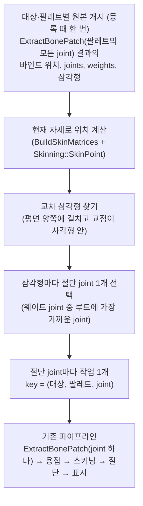

# 메시 교차 기반 단일 joint 절단 작업 설계

> 상태: **구현 완료 (J-1~J-3, 커밋 전)**. 설계 기준 커밋 `1287cb5`. J-1 `Geometry/CutPick`, J-2 원본 캐시·컨트롤러 전환(`SkeletalJoint`), J-3 상태 줄. 화면 확인(머리 절단, 팔 결과, 비스듬한 몸통 OpenLoop)은 사용자 확인 필요.
>
> 위치: NDC 발표의 **초기 구현 단계**를 재현한다. 한 작업은 joint 하나만 자른다. 여러 joint를 합치는 "한계 돌파"는 `RegionCutDesign.md`(다음 단계)에서 한다.
>
> 대체 범위: `PerSegmentCutDesign.md`의 작업 식별(선분 → 작업)만 바꾼다. 작업 목록·대상 등록·Enter/Ctrl+Z·작업별 표시·작업 색 웨이트 뷰(`b606ba4`)는 그대로 쓴다.

## 0. 목적: NDC의 한계를 직접 겪는 단계

NDC 「한계 돌파」 슬라이드 **[슬라이드]**:
- 한계점: "메시를 일부만 복사해서 자르고, 복사 범위도 본 하나로 제한되기 때문에 절단 위치나 방향이 크게 제한됨". 예시는 몸을 세로로 길게 가르는 절단이 불가능하다는 그림.
- 다음 질문: "그럼 걸친 본을 다 자르면?" → 합친 뒤 자르기.

이 단계는 슬라이드의 **한계점 상태**를 의도적으로 구현한다. 그래서 아래 결과는 버그가 아니라 **기대하는 한계**다.

| 상황 | 기대 결과 | 이유 |
| --- | --- | --- |
| 팔·다리를 가로로 자름 | 작업 1개, 절단 Ok | joint 하나의 웨이트 범위가 단면 전체를 덮는다 |
| 머리 중간을 자름 | 작업 생성 (지금은 인식 안 됨) | 메시 교차에서 출발하므로 말단 너머도 잡힌다 |
| 몸통을 비스듬히 자름 | joint마다 작업이 생기고 각각 `OpenLoop` | 절단선이 여러 joint 띠를 지나지만 작업은 띠 하나만 가진다 |
| 몸을 세로로 가름 (슬라이드 그림) | 여러 작업, 대부분 `OpenLoop` | 같은 이유 |
| 겨드랑이처럼 두 joint가 섞인 곳 | 같은 단면이 두 작업에서 두 번 잘릴 수 있다 | 두 패치가 같은 교차 삼각형을 공유한다 |

## 1. 흐름



## 2. 규칙

### 2.1 교차 삼각형
- 무한 평면(`CutPlane::ToSlicePlane`) 기준으로 세 정점 부호가 섞인 삼각형 중, 절단선 선분(평면 위의 정점과 부호가 반대인 에지의 교점을 잇는 선분)이 사각형과 만나는 것. 끝점이 사각형 안에 있는 경우뿐 아니라 선분이 사각형을 가로지르는 경우도 포함한다 (선분을 사각형에 대해 자른다, 코드 리뷰 지적 반영).
- 부호 판정은 슬라이서와 같은 규칙(ε 안이면 0). 정점이 평면에 닿기만 하는 삼각형은 제외.

### 2.2 삼각형의 절단 joint ("부모 joint")
1. 삼각형 세 정점에서 웨이트가 `w`(0.05)를 넘는 joint를 모은다.
2. 그중 **팔레트 계층에서 루트에 가장 가까운 joint**(깊이가 가장 작은 joint)를 고른다. 깊이는 `SkeletonPose::parents`를 따라 센다.
3. 깊이가 같은 joint가 여럿이면(예: 형제 joint) 세 정점 웨이트 합이 큰 joint, 그것도 같으면 번호가 작은 joint.

예: 웨이트가 {위팔, 아래팔}인 팔꿈치 삼각형 → 위팔. {torso_joint_3, arm_joint_R}인 겨드랑이 삼각형 → torso_joint_3.

### 2.3 작업
- 교차 삼각형들이 고른 절단 joint의 **서로 다른 값마다 작업 하나**. key = `MakeJointKey(대상, 팔레트, joint)` (`CutJobKind::SkeletalJoint` 추가).
- 패치는 그 joint 하나로 `ExtractBonePatch`(지금 쓰는 단일 joint 오버로드, `minWeight` 0). 개별 패치이고 합치지 않는다.
- 작업이 생기고 사라지는 처리(`DiffJobs`, 후보 해제, 확정 유지), 미리보기, Enter, Ctrl+Z, 표시는 지금 그대로다.
- 형제 선분 작업(같은 부모 joint를 두 번 자르던 문제)은 key가 joint 하나라 자연히 하나로 합쳐진다.
- 선분(`PickSegments`)은 작업 생성에 쓰지 않는다. 선분 tube 표시용으로만 남긴다.

### 2.4 원본 캐시 (BonePatch 수정 없음)
- 교차 삼각형을 찾으려면 대상 스킨 메시 전체를 현재 자세로 알아야 한다.
- **`BonePatch.*`를 고치지 않고** 기존 함수로 얻는다: 첫 편집 프레임(등록 때는 아직 포즈가 없어서 늦춘다, 실패하면 편집 모드를 다시 켤 때 재시도)에 팔레트의 모든 joint로 `ExtractBonePatch`를 한 번 부르면, 그 팔레트 스킨 메시 전체의
  - 정점별 바인드 위치·joints·weights·메시 슬롯(`BonePatchSource::vertices`)
  - 삼각형 인덱스(`ProceduralMeshData::indices`)
  - 메시 슬롯(`BonePatchSource::meshes`)
  를 얻는다. 이것을 대상의 "원본 캐시"로 보관한다.
- 매 프레임(평면이나 자세가 바뀐 프레임만) `BuildSkinMatrices(model, instance, cacheSource, matrices)`와 `Skinning::SkinPoint`로 캐시 정점을 현재 자세로 옮긴다. 패치 스키닝과 같은 식이라 위치가 일치한다.
- 비용: 등록 때 한 번의 전체 추출, 프레임마다 전체 정점 스키닝 + 삼각형 순회. CesiumMan(정점 3,273개)에서 작을 것으로 예상하지만 측정 전에는 단정하지 않는다. "교차 찾기 ms"를 표시한다.

### 2.5 재추출 기준
- 작업 key가 새로 생길 때만 추출한다(지금과 같음). 자세만 바뀌면 스키닝과 미리보기만 다시 한다.

## 3. 자료형과 함수 초안

```cpp
// Runtime/CutJob.h
enum class CutJobKind : uint8_t { SkeletalSegment, SkeletalJoint, StaticMesh };
inline CutJobKey MakeJointKey(CutTargetId target, uint32_t palette, uint32_t joint);   // a = 팔레트, b = joint

// Geometry/CutPick.h (새 파일, Model/Core 의존 없음, 단독 테스트)
struct CutPickMesh                              // 한 대상·팔레트의 현재 자세
{
    std::vector<DirectX::XMFLOAT3> positions;   // 정점의 현재 world 위치
    std::vector<SkinVertex> skins;              // 같은 순서의 joints, weights (Skinning.h)
    std::vector<uint32_t> indices;              // 삼각형 3개씩
};

struct CutPickJoint
{
    uint32_t joint = kNoNode;
    uint32_t triangleCount = 0;                 // 이 joint를 고른 교차 삼각형 수
};

class CutPick
{
public:
    // 교차 삼각형마다 절단 joint를 골라, joint별 교차 삼각형 수를 joint 오름차순으로 돌려준다.
    static void PickJoints(const CutPickMesh& mesh, const std::vector<uint32_t>& jointParents,
        const CutPlane& plane, float minWeight, float epsilon, std::vector<CutPickJoint>& out);
};
```

```cpp
// Runtime/CutJob.h의 CutTarget에 추가
struct CutTargetSource              // 팔레트별 원본 캐시
{
    std::shared_ptr<const BonePatchSource> source;   // 전체 joint 추출의 출처 (vertices, meshes)
    std::vector<uint32_t> indices;                    // 전체 추출의 삼각형
    CutPickMesh pose;                                 // 이번 프레임 위치 (skins는 등록 때 채움)
};
```

## 4. 프레임 의사 코드 (바뀌는 부분)

```text
CutController::UpdateCandidates():
    for target, palette:
        if 평면 또는 그 팔레트 자세가 바뀜:
            BuildSkinMatrices(model, instance, cache.source, matrices)
            cache.pose.positions[i] = Skinning::SkinPoint(matrices[slot], skins[i])   // 정점마다
            CutPick::PickJoints(cache.pose, skeleton.parents, m_Plane, w, eps, picked)
        for p in picked: current.push(MakeJointKey(target.id, palette, p.joint))
    ApplyDiff(DiffJobs(m_Jobs, current), ...)      // 지금 그대로
    // ExtractJob: key.b 하나로 ExtractBonePatch (지금 코드에서 key.b가 부모 joint인 것과 같다)
```

## 5. 파일별 변경

| 파일 | 변경 |
| --- | --- |
| `Geometry/CutPick.h/.cpp` (새로) | `CutPick::PickJoints` |
| `Runtime/CutJob.h` | `SkeletalJoint`, `MakeJointKey`, `CutTargetSource` |
| `Runtime/CutController.*` | 등록·팔레트 재로드 때 원본 캐시, `UpdateCandidates`를 교차 삼각형 기반으로, 선분 기반 key 생성 제거 |
| `Debug/CutDebugView.*` | 작업 줄의 "부모→자식 선분"을 "joint 이름 + 교차 삼각형 수"로, 교차 찾기 시간 |
| `tests/PlaneSlicerTests.cpp` | `PickJoints` 테스트 |
| `BonePatch.*`, `Geometry/Patch|Slice|SliceCap|Skinning`, `Rendering/*` | 없음 |

## 6. 구현 단계 (AGENTS.md: 개념 하나, 약 300줄, 단계마다 멈춤)

| 단계 | 내용 | 검증 |
| --- | --- | --- |
| J-1 | `CutPick::PickJoints` + 단위 테스트 | 한 joint 원통 가로 절단 → joint 1개, 두 joint 혼합 삼각형 → 루트 쪽 joint, 형제 joint 동률 → 웨이트 합 큰 쪽, 정점만 닿는 평면 → 없음, 사각형 밖 교차 → 제외 |
| J-2 | 원본 캐시 + 프레임 포즈 + 컨트롤러 전환 (`MakeJointKey`) | 캐시 정점 수 = 전체 추출 정점 수, 캐시 포즈 위치 = 같은 joint 패치의 포즈 위치(같은 원본 정점), 팔 가로 절단 결과가 이전과 같은 면 수 (사용자 확인 필요) |
| J-3 | 표시·UI (joint 이름, 교차 삼각형 수, 교차 찾기 시간) | 머리 절단 작업 생성, 비스듬한 몸통의 joint별 작업과 `OpenLoop` 표시 (사용자 확인 필요) |

각 단계: Debug/Release 빌드, CPU 테스트, Codex 리뷰, 보고 후 멈춤.

## 7. 한계와 다음 단계
- 0절 표의 `OpenLoop`와 이중 절단은 이 단계의 **기대 한계**다. 고치지 않는다.
- 한계 돌파: `RegionCutDesign.md` — 한 절단 고리에 걸친 joint를 합쳐 한 번에 자른다(NDC "걸친 본을 다 자르면?").
- 4주차 분리: 작업 = joint 하나이므로, 그 joint를 끊는 디버그 분리와 바로 이어진다.
