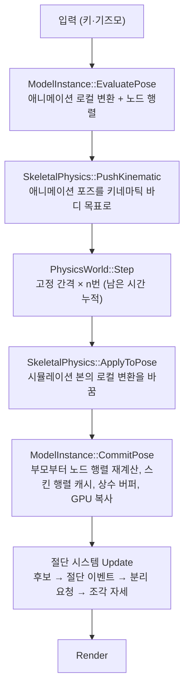

상태: 설계안, 결정 확정 — 물리 엔진 도입과 실제 BreakConstraint를 받아들일 구조 개편 (기준 커밋 `9dfcc33`). Codex 설계 검토 12건 반영 (11절). 결정 D1~D8은 설계자 추천대로 확정 (9절, 2026-10-23). 구현 전

# 물리 기반 스켈레탈 절단으로의 확장 설계

다음 작업은 물리 엔진을 넣고, 디버그 대체물 대신 실제 `BreakConstraint`로 스켈레탈 메시를 그럴듯하게 자르는 것이다.
이 단계부터 NDC 발표의 절단 시스템 전체(반복 절단, 합친 뒤 자르기, cap 부착 등)를 차례로 구현한다.
이 문서는 그 확장을 막는 지금 구조의 지점과, Unreal 구조를 따르는 목표 구조, 단계 순서를 정한다.

근거:
- 저장소 코드 (`9dfcc33`). 함수 이름으로 적는다.
- Unreal Engine 소스: `EpicGames/UnrealEngine` `release` 브랜치 `f45729c`(2026-10-20). 읽은 파일은 `KismetProceduralMeshLibrary.cpp`, `ProceduralMeshComponent.cpp`,
  `SkeletalMeshComponentPhysics.cpp`, `PhysicsEngine/PhysAnim.cpp`, `Components/SkinnedMeshComponent.cpp/.h`, `Components/SkeletalMeshComponent.cpp/.h`, `GeomTools.cpp`.
- 문서: `NDC25Reference.md`(NDC 기능과 근거 수준), `UnrealSourceComparison.md`, `CodeMap.md`, `RegionCutDesign.md`, `CutEnterCostReport.md`, `EnterCostReductionDesign.md`.

## 1. 목표와 범위

| 구분 | 내용 |
| --- | --- |
| 다음 주 목표 | 물리 엔진 통합, 스켈레톤별 물리 바디·관절, 실제 `BreakConstraint`(떨어진 부분이 중력·충돌로 움직임), 절단 조각이 물리 포즈를 따라감 |
| 이 문서가 정하는 것 | 레이어와 책임, 포즈 공간 계약, 프레임 순서, 데이터 소유, 교체 가능한 접점, 단계 순서 |
| 바꾸지 않는 것 (R·P 단계 한정) | `Geometry/`의 알고리즘과 계약, `ProceduralMesh`의 공개 API와 원자성, CPU 테스트. N-3(조각 재절단)은 `Geometry/` 계약 변경이 필요하므로 별도 설계에서 다룬다 (6.3절) |
| 범위 밖 | 울퉁불퉁한 단면(불리언), 상처 데칼, 비동기 절단, 물리 부분 블렌드(가중치 0~1)와 키네마틱 바디의 포즈 구동 |

## 2. NDC 기능 전체와 위치

`NDC25Reference.md` 4·6절의 기능을 이 설계의 단계에 대응시킨다. 근거 수준 표기는 그 문서를 따른다.

| NDC 기능 | 지금 | 이 설계의 단계 |
| --- | --- | --- |
| 절단할 Bone 선택 | 평면 교차 삼각형 → joint (`CutPick::PickJoints`) | N-1에서 물리 바디 질의를 추가 (Unreal `FHitResult.BoneName` 대응, 매핑은 5.4절) |
| 영향 범위를 ProceduralMesh로 복사 | `ExtractBonePatch` → `ProceduralMesh::Build` | 그대로 |
| 복사본 절단 + cap | `SliceProceduralMesh` | 그대로 |
| `BreakConstraint`로 관절 분리 **[슬라이드]** | 노드와 자손을 world에 고정 + 이동 (디버그, `ModelInstance::BreakConstraint`) | P-2에서 물리로 교체 |
| 늘어난 원본 마스킹 **[슬라이드]** | `UpdateSkinMask` → 셰이더 discard | 소유자만 옮김. 물리 단계의 허용 조건은 5.5절 |
| 수동 스키닝 (매 틱 정점 갱신) **[기사]** | `SkinJobs` → `UpdatePose` | 행렬 출처만 바뀜 (R-1, R-2) |
| 남는 쪽 기여 교체 **[계획서]** | `BuildPieceMatrices` | 포즈 공간 계약(4.2절)을 지키면 물리 포즈에서도 같은 식 |
| cap 본 부착 **[계획서]** | rim 정점 공유로 표면을 따라감 (`BuildCap`) | N-3 (선택) |
| 반복·다중 본 절단, 합친 뒤 자르기 **[기사]** | Enter마다 원본에서 재생성 | R-5(누적), N-3(`RegionCutDesign.md` + 재절단 계약) |
| 메시 아일랜드, 각도 보정 **[기사]** | 없음 | N-4 이후, 별도 설계 |

## 3. 지금 구조에서 확장을 막는 것

| # | 지점 | 왜 막히나 |
| --- | --- | --- |
| B1 | `ModelInstance::Update`가 애니메이션 평가, 노드 world 계산, 상수 버퍼 쓰기, joint 스킨 행렬(`posXform`) 계산, GPU 복사를 한 번의 계층 순회로 한다 | 물리가 끼어들 자리가 없다. Unreal은 애니메이션(Tick `TG_PrePhysics`) → 물리 → EndPhysics Tick의 블렌드(`BlendInPhysicsInternal` → `PerformBlendPhysicsBones`) → `FinalizeAnimationUpdate`로 포즈를 확정한다. 또 `posXform`을 매핑된 업로드 버퍼(`cb[...]`)의 `World`에서 다시 읽는데, 쓰기 결합 메모리 읽기라 분리할 때 함께 정리한다 |
| B2 | 디버그 `BreakConstraint`가 `ModelInstance` 안에서 노드와 자손의 world를 직접 고정한다 (`m_DetachedNodes`, `m_DetachedWorld`) | 물리 결과를 받을 일반 경로가 아니라 특수 상태다 |
| B3 | 끊긴 노드 집합이 두 곳에 있다: `CutTarget::brokenNodes`(컨트롤러)와 `ModelInstance`의 상태 | 물리 관절 상태까지 생기면 셋이 된다 |
| B4 | Enter는 이전 결과를 모두 지우고 원본에서 다시 만든다 (`ConfirmAll` → `DiscardCut`). 끊긴 노드가 있으면 한 프레임 되돌린 뒤 다음 프레임에 자른다. `UpdateBrokenJoints`는 집합이 바뀌면 `ResetBrokenConstraints` 후 전부 다시 끊는다 | 물리에서는 떨어진 부분의 위치·속도가 상태다. 인터페이스만 바꾸면 Enter마다 물리 상태가 초기화된다 |
| B5 | `CutController`가 외부의 행렬 생성 함수를 같은 프레임에 여러 번 부른다: `BuildSkinMatrices`(`BonePatch.cpp`), `BuildRigidMatrices`(`StaticMeshCopy.cpp`), 그리고 익명 namespace의 `BuildJobMatrices`·`BuildPieceMatrices`. pick 캐시, 작업, 조각마다 따로 만든다 | 포즈 출처가 애니메이션 + 물리로 바뀌면 바꿀 곳이 여러 곳이다. Unreal은 컴포넌트가 포즈를 소유하고 조회·계산 API(`GetBoneTransform`, `CacheRefToLocalMatrices`)를 준다. 이 API도 호출마다 계산한다. 프레임당 한 번 캐시하는 것은 이 설계의 선택이다 |
| B6 | `CutController` 하나에 대상 캐시, 후보 찾기, 작업 목록, 확정, 원본 제어, 조각 자세, 평면, 계측이 있다 | 물리 상태와 절단 이벤트가 더해지면 감당할 수 없다 |
| B7 | 무엇을 자를지 메시 CPU 스키닝으로 찾는다 (`RefreshPick`) | 물리 바디가 생기면 Unreal처럼 바디 질의로 Bone을 얻을 수 있다. 평면 pick은 디버그 도구로 남긴다 |
| B8 | 스태틱 조각은 정점을 절단 순간 world에 두고, 양쪽 조각이 같은 `CutJob::pieceWorld`(지금 메시 world × inverse(절단 순간 world))로 그려진다 (`SkinJobs`, `CutDebugView::Draw`) | 두 조각이 따로 떨어지려면 조각마다 바디와 변환이 필요하다 |
| B9 | 바인드 위치·웨이트 캐시(`CutTargetSource::pose.skins`)는 평면이 유효할 때 `UpdateTarget` → `BuildSource`로만 만든다 | 물리 자산 생성은 평면 도구와 무관하게 이 데이터가 필요하다 |

## 4. 목표 구조

### 4.1 레이어 (Unreal 대응)

| 레이어 | 새/기존 | 책임 | Unreal 대응 |
| --- | --- | --- | --- |
| `Geometry/` | 기존 | 용접, 절단, cap, 스킨 계산. Model·Core·물리에 의존하지 않는다 | `GeomTools`, `KismetProceduralMeshLibrary`의 계산 |
| `ProceduralMesh` | 기존 | 조각 하나의 기하·스킨 출처·렌더 캐시 | `UProceduralMeshComponent` |
| `ModelInstance` (포즈 소유자) | 기존, 갱신을 단계로 분리 | 애니메이션 평가, 물리 결과 반영 후 계층 재계산, 스킨 행렬 캐시와 GPU 전송 | `USkeletalMeshComponent`의 포즈 부분 |
| `Physics/PhysicsWorld` | 새 모듈 | 물리 엔진 래퍼. 고정 간격 진행, 바디·관절 생성, 질의(ray, overlap) | 물리 씬 |
| `Physics/SkeletalPhysics` | 새 모듈 | 인스턴스 하나의 본별 바디와 관절, 바디 상태, 분리, 물리 → 포즈 반영 | `USkeletalMeshComponent`의 물리 부분, Physics Asset 인스턴스 |
| `Physics/PhysicsAsset` | 새 모듈 | 스켈레톤별 바디 모양·관절 한계 (자동 생성 + 조정 파일) | `UPhysicsAsset` |
| `Runtime/` 절단 시스템 | `CutController`를 나눔 | 4.4절 | NDC 발표자가 만든 게임 코드 |
| `Debug/`, `Rendering/` | 기존 | 표시. 물리 바디 디버그 그리기 추가 | — |

의존 방향: `Runtime` → `Physics`, `ModelInstance`, `Geometry`, `ProceduralMesh`. `Physics` → 물리 엔진, `ModelInstance`(4.3절의 접점). `Geometry`는 아무것도 의존하지 않는다.
물리 엔진 헤더는 `Physics/*.cpp` 안에서만 포함한다. 엔진을 바꾸거나 언어 표준이 달라도 다른 모듈은 영향을 받지 않게 한다 (8절).

### 4.2 포즈 공간 계약

지금 코드의 공간을 먼저 고정한다. 물리 결과를 넣을 때 이 계약을 지켜야 `BuildPieceMatrices`를 그대로 쓸 수 있다.

| 기호 | 뜻 | 지금 코드 |
| --- | --- | --- |
| `N[n]` | 노드 n의 노드 행렬 (`m_NodeWorld`) | `ModelInstance::Update`가 계산. `skeletonRoot` 노드는 부모 결합을 생략하므로 모든 항목이 장면 world라는 보장은 없다 |
| `W_m` | 메시 m의 world (`N[meshCBV]`) | `BuildSkinMatrices`, `BuildRigidMatrices`가 읽음 |
| `S[j]` | 팔레트 joint j의 스킨 행렬 | `MakeSlotMatrices`: `W_m × posXform[j]`, `posXform[j] = N[jointNode] × IBM[j]` |
| joint의 장면 world | `W_m × N[jointNode]` | `ComputePoseJointWorld`, `ComputePaletteSkeleton` |

물리 결과의 변환은 다음 순서로 정의한다.

1. 바디 world `B[j]`(물리 엔진, 장면 world, 스케일 없음)
2. 본 장면 world = `B[j] × inverse(O[j])`. `O[j]`는 본 → 바디 오프셋(캡슐 중심·축). 물리 자산이 저장한다
3. 노드 행렬 = `inverse(W_m) × 본 장면 world`. 그 노드를 쓰는 모든 메시가 같은 `W_m`을 가져야 한다 (지금 `ComputePaletteSkeleton`이 이미 검사하는 조건)
4. 스케일: ModelViewer는 인스턴스를 `Resize`로 축소한다. 물리 엔진 변환에는 스케일이 없으므로 회전·이동만 바디로 보내고, 스케일은 애니메이션 포즈에서 가져와 3단계 뒤에 다시 곱한다

이 계약을 지키면 `BuildPieceMatrices`의 추종 변환(지금 노드 world × inverse(절단 순간 노드 world))이 물리 포즈에서도 같은 의미를 갖는다. 어긋나면 조각이 원본에서 미끄러진다.

### 4.3 프레임 순서와 포즈 단계

포즈 접점은 세 단계로 나눈다. 쓰는 쪽과 시점이 다르다.

| 단계 | 쓰는 쪽 | 읽고 쓰는 것 | 유효 시점 |
| --- | --- | --- | --- |
| 애니메이션 포즈 읽기 | `PushKinematic`, 물리 자산 생성 | 애니메이션 로컬 변환과 노드 행렬 | `EvaluatePose` 뒤 |
| 물리 결과 쓰기 | `ApplyToPose` | 시뮬레이션 본의 로컬 변환 | `EvaluatePose`와 `CommitPose` 사이 |
| 최종 포즈 읽기 (`IPoseSource`) | 절단 시스템, 조각 | 노드 행렬, 메시 world, 스킨 행렬 | `CommitPose` 뒤 |

- **`ApplyToPose`의 규칙 (P-2 범위, 가중치 1만):** 부모부터 순회한다. 시뮬레이션 본은 "최종 부모 노드 행렬 기준 상대 변환"으로 로컬 변환을 바꾼다. 바디가 없거나 시뮬레이션이 아닌 자손은 애니메이션 로컬 변환 × 최종 부모로 다시 계산한다(`CommitPose`의 계층 순회). UE `PerformBlendPhysicsBones`와 같은 구조다. UE는 물리 변환을 `GetRelativeTransform`으로 부모 기준 로컬로 바꿔 `PhysicsBlendWeight`로 블렌드한 뒤 component space를 부모부터 다시 계산한다. 부분 블렌드와 키네마틱 바디의 포즈 구동은 지원하지 않는다 (1절).
- 물리가 없으면 C·D·E를 건너뛰고 B 다음 바로 F다. 그래서 R-0은 동작이 바뀌지 않는다.
- **고정 간격:** 한 화면 프레임에 여러 번 진행하면 키네마틱 목표는 이번 프레임 애니메이션 포즈 하나를 모든 단계에 쓴다(1차 범위). 화면에는 마지막 시뮬레이션 상태를 쓴다. 이전·현재 상태 보간은 떨림을 보고 P-2에서 정한다 (10절).
- **새 동적 바디의 시작 시점:** 절단 이벤트는 G에서 일어난다. 분리 요청은 그 프레임의 최종 포즈로 바디를 시뮬레이션으로 바꾸고 충격량을 기록한다. 실제 움직임은 다음 프레임 D부터다. 조각은 이번 프레임 포즈로 만들어지므로 어긋나지 않는다.
- **Unreal 대응:** 애니메이션 Tick은 `TG_PrePhysics`, 종료 Tick은 `TG_EndPhysics`다(`USkeletalMeshComponent` 생성자, `RegisterEndPhysicsTick`). `EndPhysicsTickComponent` → `BlendInPhysicsInternal`이 애니메이션 평가 완료를 기다린 뒤 블렌드한다. 물리 경로의 최종 포즈를 읽는 쪽은 EndPhysics 블렌드 뒤(예: `TG_PostPhysics`)에 읽는다. 우리 G의 위치가 이것에 해당한다.

### 4.4 절단 시스템 분리

| 단위 | 맡는 함수 (지금 위치: `CutController`) | 비고 |
| --- | --- | --- |
| `CutTargetRegistry` | `RegisterInstance`, `UnregisterInstance`, `InitializeTargetModelData`, 대상별 캐시 수명, **바인드 데이터**(B9: 평면과 무관하게 등록 후 첫 포즈에서 만든다) | 대상 = 인스턴스 + 물리 핸들 + 원본 캐시 |
| `CutHitQuery` (인터페이스) | 평면 구현: `UpdateTarget`, `BuildSource`의 pick 부분, `RefreshPick`, `PickStaticMeshes`, `InitCutStaticMesh` | 출력 형식은 5.4절 |
| `CutExecutor` | `ConfirmJob`, `ExtractJob`, `SkinPatch`, `SliceWithPlane` | 입력: 후보 + 평면. 출력: 절단 이벤트. 실패 원자성은 5.6절 |
| `CutPieceSet` | `SkinJobs`, `BuildPieceMatrices`, `BuildJobMatrices`, `SetBreakOf`의 스냅샷 부분 | 조각 수명과 매 프레임 자세. 행렬은 `IPoseSource`에서 |
| `OriginalControl` | `UpdateSkinMask`, `SetOriginalVisible`, `UpdateBrokenJoints` | 마스크·숨김은 직접, 분리는 `ISkeletonBreaker`에 요청 |
| `CutController` | `Update`의 순서, 평면 편집(`ToggleEditPlane`, `PlacePlane`, `UpdateGizmo`), 계측 | 조율만 한다 |

### 4.5 교체 가능한 접점

| 접점 | 지금 구현 | 다음 구현 | 계약 |
| --- | --- | --- | --- |
| `IPoseSource` (`ModelInstance`) | — | `CommitPose`에서 프레임당 한 번 캐시 | 최종 포즈 읽기 전용. 조회 key는 (인스턴스, 팔레트, **Model 메시 번호**). 작업마다 다른 `meshSlot`은 key가 아니다 |
| `ISkeletonBreaker` | 디버그 고정 (지금 `ModelInstance::BreakConstraint`의 동작을 옮김) | 물리 (`SkeletalPhysics`) | `TryBreak(노드, 충격량, 위치)` → 신규 분리 / 이미 분리됨 / 실패. **기존 분리를 건드리지 않는 증분 요청.** `Reset`은 명시적 전체 초기화(Ctrl+Z)에만. 끊긴 노드 집합의 유일한 소유자 (B3) |
| `CutHitQuery` | 평면 + 메시 교차 | 물리 바디 질의 | 출력이 같아 `CutExecutor`는 모른다 |
| `PhysicsWorld` | — | 선택한 엔진 하나 | 엔진 타입이 헤더에 드러나지 않는다 |

## 5. 실제 BreakConstraint

### 5.1 Unreal 순서와 대응 (UE `SkeletalMeshComponentPhysics.cpp::BreakConstraint`)

| Unreal | 이 설계 |
| --- | --- |
| constraint 이름으로 `FindConstraintIndex`. 없거나 이미 종료됐으면 바로 반환 | `SkeletalPhysics`가 노드 → 관절 표를 가진다. 없음·이미 분리는 `TryBreak` 결과로 돌려준다 |
| `GetChildBoneName()`으로 자식 바디를 찾아 시뮬레이션 켬 | 끊는 노드의 바디를 시뮬레이션으로 |
| `TermConstraint` | 관절 제거 |
| `UpdateMeshForBrokenConstraints`: 자신과 자손 바디를 시뮬레이션으로 바꾸고 drive를 끔. 자손 관절은 종료하지 않음 | 같음. 떨어진 부분은 래그돌처럼 휜다 |
| `AddImpulseAtLocation` | 절단 평면 법선 방향 충격량. 지금의 `kBreakOffsetRatio` 이동을 대신한다 |
| EndPhysics의 `PerformBlendPhysicsBones` | `ApplyToPose` + `CommitPose` (4.3절) |

메시는 손대지 않는다. 늘어남은 마스킹이 처리한다 (5.5절의 조건).

### 5.2 바디와 관절 (Physics Asset)

- glTF에는 물리 정의가 없으므로 스켈레톤에서 **자동 생성**하고, 필요하면 조정 파일로 덮어쓴다.
- 입력은 `CutTargetRegistry`의 바인드 데이터(바인드 위치·웨이트, B9)다. 평면 도구와 무관하다.
- 바디: 웨이트가 있는 joint마다 캡슐 하나. 축은 joint → 자식 joint, 반지름은 그 joint 웨이트가 큰 바인드 정점까지 거리 분포로 정한다. 본 → 바디 오프셋 `O[j]`를 저장한다 (4.2절).
- 말단 joint(손끝, 머리 끝)는 웨이트 정점의 bounds로 캡슐을 만든다 (`NDC25Reference.md` 9절).
- 관절: 부모 바디와 자식 바디 사이에 swing/twist 한계가 있는 관절 하나. 바디 없는 joint를 건너뛰면 가장 가까운 바디 있는 조상과 잇는다.
- 바디 사이 충돌은 부모-자식 쌍을 끈다.

### 5.3 조각이 물리 포즈를 따라가는 방법

- `BuildPieceMatrices`는 노드 행렬만 읽는다. 4.2절 계약대로 물리 결과가 노드 행렬에 들어오면 같은 식이 물리 포즈를 따른다.
  - 떨어지는 조각: 끊긴 서브트리 joint는 시뮬레이션 포즈로 스키닝된다. 서브트리 밖 joint의 기여는 "끊긴 노드 행렬 × inverse(절단 순간 값)"으로 따라간다.
  - 남는 조각: 서브트리 joint의 기여를 절단 순간 값으로 부모에 붙여 따라간다. NDC "떨어진 본의 정점 기여를 절단 당시 위치로 교체"에 해당한다.
- 스태틱 조각(P-3): 조각마다 바디 핸들, 절단 순간 바디 world `BodyAtCut`, 렌더 변환을 따로 저장한다. 정점은 지금처럼 절단 순간 world에 두고, 렌더 변환 = `BodyNow × inverse(BodyAtCut)`. 양쪽이 공유하는 `pieceWorld`(B8)는 조각별 값으로 바꾼다.
  - 충돌체: 조각 정점으로 convex hull 하나를 만든다. hull은 바디 로컬(질량 중심 기준) 좌표로 저장한다. 점이 너무 적거나 부피가 0이면 바디를 만들지 않고 조각을 정적으로 둔다. 오목한 조각도 hull 하나로 근사한다(9절 D7).
  - Unreal `SliceProceduralMesh`는 원본 convex 충돌체를 평면으로 자르고 반대쪽 컴포넌트를 만들지만, 시뮬레이션을 자동으로 켜지는 않는다. 우리 스태틱 복사에는 원본 충돌체가 없으므로 조각에서 새로 만든다.

### 5.4 질의 결과와 joint·바디 매핑

- `CutHitQuery`의 출력: (대상 ID, **Model 노드 번호** 목록 또는 스태틱 메시 번호, 교차 정보).
- `CutExecutor`가 노드를 작업 key로 바꾼다: 그 노드를 joint로 가진 모든 팔레트에서 팔레트 로컬 joint 번호를 찾는다(`m_JointIndices[palette.startJoint + j]`의 역표). 지금 `ExtractJob`이 쓰는 (팔레트, 로컬 joint) key는 이 변환의 결과다.
- `SkeletalPhysics`는 바디 ↔ 노드 ↔ 관절 표를 가진다.
- 끊을 노드: 작업 joint의 노드에 바디가 있으면 그 노드, 없으면 바디가 있는 가장 가까운 조상. 어느 쪽도 없으면 분리 없이 절단만 한다(디버그 표시).

### 5.5 마스킹 허용 조건 (P-2)

- `ReadBonePatch`는 분리 서브트리와 바깥 joint에 함께 가중된, 패치 밖 삼각형 수를 `mixedOutsideTriangles`로 센다. 이 삼각형은 마스크되지 않아 분리 뒤 늘어난다. 지금 `ConfirmJob`은 이 값을 확인하지 않는다.
- P-2는 `mixedOutsideTriangles == 0`인 절단만 분리를 허용한다. 0이 아니면 절단은 하되 분리하지 않고 상태 줄에 이유를 표시한다.
- 서브트리 전체의 혼합 영역까지 추출·대체하는 일반 해결은 N-3에서 다룬다.
- 물리로 떨어진 거리가 커지면, 지금 디버그 이동보다 이 누락 영역의 늘어남이 크게 보일 것이다. 이는 추론이다.

### 5.6 절단 이벤트의 원자성

순서를 바꿔 "분리할 수 있는지 먼저 확인하고, 그다음 게시"한다. 지금 `ConfirmJob`은 조각 게시·원본 숨김 뒤에 `SetBreakOf`를 하고, 실제 분리는 나중에 `UpdateBrokenJoints`에서 한다.

1. 추출 → 현재 자세 → 절단 → 범위 승인 (지금과 같음, 실패하면 아무것도 바뀌지 않는다)
2. `ISkeletonBreaker`에 분리 가능 여부 확인 (관절 존재, 미분리, 5.5절 조건)
3. 조각 게시, 마스크·숨김, 스냅샷 저장
4. `TryBreak` 요청. 같은 프레임 여러 작업이 같은 노드를 가리키면 충격량은 한 번만 준다

## 6. 절단 이벤트와 누적 (B4 해결)

### 6.1 이벤트

| 항목 | 내용 |
| --- | --- |
| 절단 이벤트 | 절단 한 번의 결과: 조각 둘(`ProceduralMesh` `shared_ptr`), 작업 key, 평면, 끊은 노드, 스냅샷(`breakCutMatrices` 등), 조각별 쪽(남는/떨어지는), 스태틱이면 조각별 바디 핸들과 `BodyAtCut` |
| 저장 | `CutPieceSet`이 이벤트 목록을 가진다. `CutDebugView`는 이벤트의 조각을 그대로 그린다 (같은 `shared_ptr` 규칙 유지) |
| 다음 절단의 대상 | 원본에서 아직 숨기지 않은 범위만. 이미 끊긴 서브트리의 joint는 후보에서 뺀다 |
| Ctrl+Z | 명시적 전체 초기화: 이벤트 삭제, 마스크·숨김 해제, `ISkeletonBreaker::Reset`, 물리 바디를 애니메이션 포즈로 되돌림 |

### 6.2 지금 방식에서 바꾸는 것

- `ConfirmAll`의 `DiscardCut` 호출, `Update`의 2프레임 우회, `UpdateBrokenJoints`의 전체 재설정을 없앤다. 분리는 증분 요청(`TryBreak`)만 쓴다.
- 이 변경(R-5)은 **물리 분리(P-2)보다 먼저** 한다. 순서가 반대면 P-2가 Enter마다 물리 상태를 지운다.
- "원본에서 재생성" 동작은 남기지 않는다 (9절 D3). 같은 결과는 Ctrl+Z 뒤 다시 자르면 얻는다.

### 6.3 조각 재절단 (N-3, 별도 설계 필요)

지금 `Slicer::ProcessFace`는 cap 면을 가로지르면 `CrossesCap`, `Slicer::Run`은 기존 cap이 양쪽에 놓이면 거절한다. 조각을 다시 자르려면 cap 재절단 규칙과, 원본과 조각의 스킨 출처를 합치는 규칙이 필요하다. `Geometry/` 계약을 바꾸는 일이므로 `RegionCutDesign.md`와 함께 N-3 전에 따로 설계한다.

## 7. 단계 계획

AGENTS.md 규칙대로 한 단계 = 개념 하나, 약 300줄, 단계마다 멈춘다. R은 동작을 바꾸지 않는 구조 정리(R-5만 예외), P는 물리, N은 NDC 기능 확장이다.
단계마다 공통 확인: Debug/Release 빌드, `Geometry/`를 건드리면 CPU 테스트, Codex 리뷰(약 2~5분), 화면 확인은 사용자. 변경량은 추정이며 빌드·테스트 시간은 아직 측정하지 않았다.

| 단계 | 내용 | 변경량 추정 | 동작 변화 | 확인 |
| --- | --- | --- | --- | --- |
| R-0 | `ModelInstance::Update`를 `EvaluatePose` / `CommitPose`로 나누고 로컬 변환을 보관. `posXform`을 CPU 노드 행렬에서 계산 | 약 150줄 | 없음 | 화면·절단 동일 |
| R-1 | `IPoseSource`: (인스턴스, 팔레트, 메시 번호) key의 최종 행렬 캐시. `BuildSkinMatrices`·`BuildRigidMatrices` 호출을 캐시 읽기로 | 약 150줄 | 없음 | 행렬 비트 동일 (임시 비교) |
| R-2 | `CutPieceSet` 분리: `SkinJobs`, `BuildPieceMatrices`, 스냅샷 | 약 250줄 이동 | 없음 | 절단·분리 화면 동일 |
| R-3 | `ISkeletonBreaker`(`TryBreak`/`Reset`) + 디버그 구현으로 지금 분리를 옮김. 끊긴 노드 집합을 한 곳으로 | 약 200줄 | 없음 | 분리 화면 동일 |
| R-4a | `CutHitQuery` 인터페이스 + 평면 구현으로 pick 묶음 이동, 바인드 데이터를 `CutTargetRegistry`로 (B9) | 약 300줄 이동 | 없음 | 후보 동일 |
| R-4b | `CutExecutor` 분리 + 5.6절 순서 (확인 → 게시 → 분리) | 약 200줄 | 없음 (디버그 분리는 항상 성공) | 확정 동일 |
| R-4c | `OriginalControl` 분리 | 약 120줄 | 없음 | 마스크·숨김 동일 |
| R-5 | 절단 이벤트 누적 (6절): `DiscardCut` 자동 호출·2프레임 우회·전체 재설정 제거, 끊긴 서브트리 후보 제외 | 약 250줄 | **Enter가 누적됨** | 두 번 연속 절단 |
| P-0 | 물리 엔진 통합 (사용자 승인 후 라이브러리 추가), `PhysicsWorld` 생성·고정 간격 진행·종료, 바닥 평면, 디버그 그리기 | 약 300줄 | 바닥만 생김 | 빌드, 빈 씬 진행 |
| P-1a | `PhysicsAsset` 자동 생성 (캡슐, 오프셋 `O[j]`, 관절 한계) + 디버그 표시 | 약 250줄 | 표시만 | 캡슐 배치 (사용자 확인) |
| P-1b | `SkeletalPhysics` 바디·관절 생성, 바디 ↔ 노드 ↔ 관절 표 (5.4절) | 약 200줄 | 없음 | 표 검증 |
| P-1c | `PushKinematic`: 키네마틱 바디가 애니메이션을 따라감 | 약 150줄 | 표시만 | 캡슐이 몸을 따라감 |
| P-2 | 물리 `ISkeletonBreaker`: 시뮬레이션 전환, 관절 제거, 충격량, `ApplyToPose` (4.2·4.3절 계약), 5.5절 조건 | 약 300줄 | **떨어진 부분이 물리로 움직임** | 팔 절단 → 낙하·바닥 충돌, 조각이 따라감, 남는 쪽 늘어남 없음 |
| P-3 | 스태틱 조각 강체 (5.3절): 조각별 바디·hull·렌더 변환 | 약 250줄 | 스태틱 조각이 떨어짐 | 큐브·버니 절단 후 낙하 |
| N-1 | 물리 `CutHitQuery`: ray/overlap → 바디 → 노드 → 작업 key (5.4절) | 약 200줄 | 입력 방식 추가 | 평면 pick과 결과 비교 |
| N-2 | (예약) 물리 경로 Enter 비용 재측정과 `EnterCostReductionDesign.md` 반영 | — | — | 실측 |
| N-3 | 합친 뒤 자르기, 조각 재절단 계약 (6.3절), 혼합 영역 일반 해결 (5.5절), (선택) cap 본 부착 | 별도 설계 | 다중 본 절단 | — |
| N-4 | 메시 아일랜드, 각도 보정 | 별도 설계 | — | — |

다음 주 범위 (D2 확정): R-0 → R-1 → R-2 → R-3 → R-4b → R-5 → P-0 → P-1a → P-1b → P-1c → P-2. R-4a·R-4c는 P 단계와 독립이라 뒤로 미룬다.

## 8. 물리 엔진 선택 (D1 확정: PhysX 5)

선택 이유: 이 프로젝트는 Unreal 구조를 따른다. PhysX는 UE4가 `BreakConstraint`를 구현할 때 쓴 엔진이라 바디·관절·시뮬레이션 전환·충격량이 같은 개념으로 대응한다.
C++11 이상이면 되므로 지금 프로젝트 설정(추정 C++14)을 바꾸지 않아도 된다. 통합이 무거운 점은 4.1절의 구현 숨김으로 `Physics/` 안에 가둔다.
Jolt는 더 가볍지만 C++17이 필요하고 Unreal과의 대응이 한 단계 멀다. 통합이 막히면 4.5절 `PhysicsWorld` 뒤에서 Jolt로 바꾼다.

| 항목 | PhysX 5 | Jolt Physics | Bullet 3 |
| --- | --- | --- | --- |
| 라이선스 | BSD-3 | MIT | zlib |
| Unreal과의 유사성 | UE4의 물리 엔진. 바디·D6 관절·`BreakConstraint` 개념이 그대로 대응 (UE5는 Chaos) | 개념은 같음 (바디, 제약, 래그돌 유틸) | 개념은 같음 |
| 래그돌 구성 | 바디 + D6 관절 직접 구성 (articulation도 있음) | 래그돌·스켈레톤 매핑 유틸 제공 | 직접 구성 |
| 언어 표준 | C++11 이상 | C++17 필요 | C++03 이상 |
| 통합 무게 | 큼 (빌드·DLL 여러 개) | 작음 (정적 라이브러리 하나) | 중간 |

- 이 저장소의 프로젝트 파일에는 `LanguageStandard` 지정이 없다 (`PropertySheets`, `MeshCutting.vcxproj`, `ModelViewer.vcxproj`에서 확인). v143 기본값(C++14)으로 보이나 빌드 로그로 확인하지 않았다. Jolt를 고르면 `Physics/`만 C++17로 빌드하고 엔진 헤더를 `Physics/*.cpp` 안에 가둔다.
- 엔진 추가는 외부 패키지를 내려받는 일이므로 사용자 승인 후 P-0에서 한다. `vcpkg.json`에 넣을지, 소스를 따로 둘지도 그때 정한다.
- 이 표의 엔진 기능 서술은 각 엔진의 공개 자료에 대한 일반 지식이며, 이 저장소에서 빌드해 확인하지 않았다.

## 9. 결정 목록 (2026-10-23, 사용자가 설계자 추천대로 확정)

| # | 질문 | 선택지 | 결정 | 이유 |
| --- | --- | --- | --- | --- |
| D1 | 물리 엔진 | PhysX 5 / Jolt / Bullet | **PhysX 5** | 8절 |
| D2 | 다음 주 범위 | 7절 제안 / 다른 범위 | **R-0 ~ R-3, R-4b, R-5, P-0 ~ P-2** | R-4b의 확인→게시→분리 순서는 P-2 전에 필요하다. R-4a·R-4c는 뒤로 |
| D3 | "원본에서 재생성" 디버그 동작 | 별도 키로 유지 / 제거 | **제거** | 누적 방식과 두 경로를 함께 유지할 이유가 적다. Ctrl+Z 전체 초기화 후 다시 자르면 같은 결과다 |
| D4 | Physics Asset | 자동 생성만 / 자동 + 조정 파일 | **자동 생성만으로 시작**, 조정 파일은 P-2 화면 확인 뒤 필요하면 추가 | 단계 크기를 지킨다 |
| D5 | 평면 pick | 디버그 도구로 유지 / N-1 후 제거 | **디버그 도구로 유지** | 물리 질의와 결과를 비교하는 기준이 된다 |
| D6 | `mixedOutsideTriangles != 0`일 때 | 분리 안 함 / 분리하고 늘어남 허용 | **분리 안 함** (절단만, 이유를 상태 줄에) | 늘어남을 보여 주지 않는 것이 NDC 결과에 가깝다 |
| D7 | 스태틱 조각 충돌체 | hull 하나 근사 / 볼록 분해 | **hull 하나 근사** | 큐브·버니 시연에 충분하다 |
| D8 | 고정 간격 값과 보간 | 1/60 s, 보간 없음 / 보간 | **1/60 s, 보간 없음**, P-2에서 떨림이 보이면 보간 추가 | 가장 단순한 것부터 |

## 10. 위험과 확인할 것

- R-0은 엔진 `ModelInstance`를 바꾼다. 원본 렌더링 전체가 영향을 받으므로 동작 동일을 먼저 확인한다.
- 4.2절 계약이 깨지면 조각이 원본에서 미끄러진다. P-2에서 정지 자세로 절단한 뒤 분리 직후 프레임의 조각과 원본 경계를 비교한다.
- 물리 고정 간격과 화면 프레임이 다르면 떨어지는 조각이 떨린다 (D8).
- 자손 관절을 유지하면 떨어진 팔이 휘고, 조각은 스키닝으로 따라 휜다. cap은 rim을 공유하므로 함께 휜다. 평면성이 얼마나 깨지는지 화면으로 확인한다.
- Enter 비용(`CutEnterCostReport.md`)은 이 설계로 줄지 않는다. `EnterCostReductionDesign.md`는 독립적으로 진행한다.
- 확인하지 않은 것: NDC가 Bone을 어떻게 골랐는지, 기여 교체의 정확한 식, cap 부착 방식 (`NDC25Reference.md` 10절).

## 11. Codex 설계 검토 대응 (12건)

| # | 등급 | 지적 | 반영 |
| --- | --- | --- | --- |
| 1 | High | 물리 world를 노드 배열에 바로 넣을 수 없다 (`skeletonRoot`, `W_m × posXform`) | 4.2절 포즈 공간 계약 |
| 2 | High | `PerformBlendPhysicsBones`는 로컬로 바꿔 계층을 재계산한다 | 4.3절 `ApplyToPose` 규칙, 부분 블렌드 범위 밖 (1절) |
| 3 | High | 상태 보존을 P-2 뒤로 미루면 물리 상태가 지워진다 | R-5를 P-2 앞으로, `TryBreak` 증분 계약 (4.5·6.2절) |
| 4 | High | 스태틱 조각 바디·렌더 변환 계약 부족, `pieceWorld` 공유 | 5.3절 조각별 `BodyAtCut`·렌더 변환·hull 규칙, D7 |
| 5 | Medium | 포즈 접점의 시점과 캐시 key, 평면과 무관한 바인드 데이터 | 4.3절 세 단계 표, 4.5절 key, B9·R-4a |
| 6 | Medium | 바디 joint와 작업 key 매핑 | 5.4절 |
| 7 | Medium | Unreal 최종 포즈 보장은 EndPhysics 블렌드 뒤 | 4.3절 Unreal 대응, 고정 간격·새 바디 시작 시점 |
| 8 | Medium | 마스크로 늘어남이 항상 해결되지 않음 | 5.5절, D6 |
| 9 | Medium | 물리 분리 실패를 포함한 원자성 | 5.6절, R-4b |
| 10 | Medium | 조각 재절단과 Geometry 계약 불변의 충돌 | 1절 범위 한정, 6.3절 |
| 11 | Medium | 단계 크기 | R-4·P-1 분할, 변경량 추정 표시 |
| 12 | Low | 함수 소유와 Unreal 캐시 설명 | B5 정정 |
