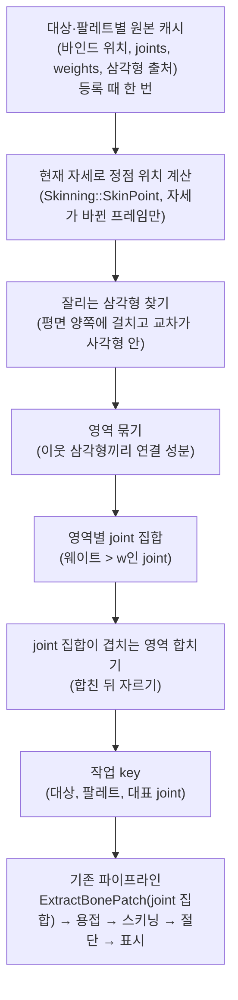

# 메시 교차 기반 절단 작업 설계 (영역 작업)

> 상태: **설계안, 보류** (기준 커밋 `1287cb5`). `JointCutDesign.md`(단일 joint 작업) 다음의 "한계 돌파" 단계로 진행한다.
>
> 대체 범위: `PerSegmentCutDesign.md`의 **작업 식별(선분 → 작업)과 추출 기준(부모 joint 하나)**만 대체한다. 작업 목록·대상 등록·Enter/Ctrl+Z·작업별 표시·작업 색 웨이트 뷰(이미 구현, `b606ba4`)는 그대로 쓴다.
>
> 참고: `NDC25Reference.md` 4절·6절, `PerSegmentCutDesign.md`, `CurrentFlowReport.md`

## 0. 왜 바꾸나

선분 기준(`CutPlane::PickSegments` → `MakeSegmentKey` → 부모 joint 하나로 `ExtractBonePatch`)에서 두 가지 실패가 확인됐다(2026-10-21 실행 화면).

| 현상 | 원인 |
| --- | --- |
| 머리·손이 인식되지 않음 ("No bone segment crosses the plane") | 말단 joint(`neck_joint_2`, 팔 끝 9·10) 너머에는 부모→자식 선분이 없다. 머리 메시는 z 1.51까지 있지만 마지막 joint는 z 1.19 |
| 비스듬한 몸통이 `OpenLoop` | 패치가 `torso_joint_2` 웨이트 띠(z 약 0.64~1.14)뿐이라, 기울어진 평면의 절단선이 띠 위·아래로 나가 패치 경계에 닿는다 |

두 실패 모두 "뼈에서 출발해 메시를 찾는" 방향 때문이다. 이 설계는 방향을 뒤집어 **실제로 잘리는 메시에서 출발해 joint를 찾는다.**

## 1. NDC와의 관계

| NDC (`NDC25Reference.md`) | 이 설계 |
| --- | --- |
| 절단 위치에서 Bone을 선택하고 그 Bone의 영향 범위를 복사 **[슬라이드]** | 절단 위치에서 **실제로 잘리는 삼각형**을 찾고, 그 삼각형을 움직이는 joint들의 영향 범위를 복사 |
| 여러 본이 겹친 영역은 **합친 뒤 자르기** **[기사]** | 웨이트로 이어진 영역은 **한 작업으로 합친 뒤** 한 번 자름 (3.3절) |
| Bone 선택 방법은 미확인 | 메시 교차로 정함. `BreakConstraint`에 해당할 "끊을 joint"는 따로 기록(3.4절) |

다중 본 처리(합친 뒤 자르기)와 "실제 절단 위치에서 시작"한다는 점에서 NDC 흐름에 더 가깝다. 다만 NDC가 Bone을 어떻게 골랐는지는 확인되지 않았으므로, "NDC와 같은 방식"이라고 단정하지 않는다.

## 2. 큰 흐름



H 이후(작업 목록, `DiffJobs`, 미리보기, Enter, Ctrl+Z, 작업별 표시, 작업 색 웨이트 뷰)는 지금 구현을 그대로 쓴다.

## 3. 세부 규칙

### 3.1 잘리는 삼각형
- 무한 평면(`CutPlane::ToSlicePlane`) 기준으로 세 정점의 부호가 섞인 삼각형 중, 삼각형과 평면의 교선 위의 점(교차 에지의 교점)이 하나라도 사각형 안(`CutPlane::Contains`)인 것.
- 부호 판정은 슬라이서와 같은 규칙(ε 안이면 0)을 쓴다. 정점이 평면 위에만 닿는 삼각형은 잘리는 삼각형이 아니다.

### 3.2 영역과 joint 집합
- **영역:** 잘리는 삼각형끼리 원본 정점(같은 메시 슬롯·같은 원본 정점 번호 또는 같은 바인드 위치)을 공유하면 같은 영역이다. 평면이 두 팔과 몸통을 지나면 보통 영역 3개가 나온다.
- **joint 집합:** 영역의 잘리는 삼각형 정점에서 웨이트가 `w`를 넘는 joint 전부. 기본 `w = 0.05`.
- **닫힘 성질:** 정점의 웨이트는 최대 4개, 합이 1이라 모든 정점에 0.25 이상인 joint가 있다. `w ≤ 0.25`이면 잘리는 삼각형은 모두 그 영역의 패치에 들어간다. 절단선이 패치 경계를 넘으려면 경계 너머 삼각형도 잘리는 삼각형이어야 하는데, 그 삼각형은 같은 영역이므로 이미 패치 안이다. 그래서 **사각형 안에서는 `OpenLoop`가 생기지 않는다.** 남는 실패는 평면 가장자리가 메시 안에서 끝나는 부분 절개(`LoopOutsidePlane`)뿐이다.
- 추출 조건은 지금 `ExtractBonePatch` 집합 오버로드와 같다("정점 하나라도 집합 joint 웨이트 > minWeight"). `minWeight`를 같은 `w`로 넘긴다(지금 컨트롤러는 0.0).

### 3.3 합친 뒤 자르기 (웨이트로 이어진 영역)
- 영역 A의 joint 집합에 joint j가 있고 영역 B의 잘리는 삼각형에도 j 웨이트가 `w`를 넘으면, A의 패치에 B의 잘리는 삼각형이 들어간다. 따로 자르면 같은 곳을 두 번 자르게 된다.
- 그래서 **joint 집합이 겹치는 영역은 한 작업으로 합친다**(겹침 관계의 연결 성분). 합친 작업의 joint 집합은 합집합이다.
- 예: 겨드랑이 근처를 지나는 평면 → 몸통 영역 joint 집합에 `arm_joint_R`(6)이 들어감 → 오른팔 영역과 합쳐 한 작업.
- 이 규칙 덕분에 지금의 "형제 선분 중복"(같은 부모 joint 패치를 두 번 자름)과 "이웃 joint 중복"이 한 작업 안으로 들어가 사라진다.
- `PerSegmentCutDesign.md`의 "여러 선분의 패치를 합치지 않는다"는 이 설계에서 **"웨이트로 이어지지 않은 영역끼리는 합치지 않는다"**로 바뀐다.
- **남는 겹침:** joint 집합이 서로소인 두 작업도, 두 집합의 joint에 함께 걸친 혼합 삼각형(예: 팔꿈치)은 두 패치에 모두 들어갈 수 있다. 그 삼각형은 어느 쪽에서도 잘리지 않으므로 절단 결과는 맞지만, 같은 원본 삼각형이 두 조각에 복사된다. 복사본 표시 데모에서는 허용하고, 원본 교체 단계에서 삼각형 소유권 정책(`PerSegmentCutDesign.md` 6.3절)으로 다룬다.
- **합친 작업의 조각은 섬이 여러 개다:** 몸통+오른팔 작업을 자르면 positive/negative 조각에 각각 떨어진 덩어리가 여럿 생긴다. 표시에는 문제없지만, 4주차 분리에서는 섬 단위로 나눠야 한다.

### 3.4 작업 key와 끊을 joint
- **key:** `CutJobKind::SkeletalRegion` 추가, `a` = 팔레트, `b` = 대표 joint, `c` = 사용 안 함. 대표 joint = 작업의 잘리는 삼각형 정점 웨이트 합이 가장 큰 joint. 같은 팔 위에서 평면을 미끄러뜨리는 동안 key가 유지된다.
- 대표 joint가 프레임마다 흔들리면 재추출이 반복된다. 대표 joint가 같아도 **joint 집합이 바뀌면** 재추출한다(작업에 집합을 저장하고 비교).
- **끊을 joint(4주차 분리용, 이번엔 기록만):** 작업 영역을 지나는 뼈 선분(`PickSegments` 결과 중 교점이 그 영역 근처인 것)이 있으면 그 부모 joint, 없으면(머리·손) 대표 joint. `PickSegments`는 이 기록과 선분 tube 표시에 계속 쓴다.

### 3.5 원본 캐시와 비용
- 잘리는 삼각형을 찾으려면 대상의 스킨 메시 전체를 현재 자세로 알아야 한다. 원본 해석(packed 정점 디코드)은 등록 때 한 번만 하고, 프레임마다 스키닝만 한다.
  - 캐시: 메시 슬롯별 바인드 위치, joints, weights, world 행렬 번호, 삼각형(원본 정점 번호 3개 + (mesh, draw, primitive)).
  - 자세 갱신: `Skinning::SkinPoint`(패치 스키닝과 같은 식).
- 계산 시점: 평면이 바뀌었거나 그 대상의 자세가 바뀐 프레임만. 애니메이션 중에는 매 프레임이다.
- CesiumMan은 정점 3,273개라 작을 것으로 예상하지만, **측정 전에는 단정하지 않는다.** 작업 표시줄에 "영역 찾기 ms"를 추가한다.

## 4. 자료형과 함수 초안

```cpp
// Runtime/CutJob.h
enum class CutJobKind : uint8_t { SkeletalSegment, SkeletalRegion, StaticMesh };
CutJobKey MakeRegionKey(CutTargetId target, uint32_t palette, uint32_t representativeJoint);

// 새 파일 Geometry/CutRegion.h (Model/Core 의존 없음, 단독 테스트 대상)
struct CutRegionInput                       // 한 대상·팔레트의 현재 자세
{
    std::vector<DirectX::XMFLOAT3> positions;           // 원본 정점의 현재 world 위치
    std::vector<SkinVertex> skins;                       // 같은 순서: joints, weights (Skinning.h)
    std::vector<uint32_t> triangles;                     // 원본 정점 번호 3개씩
};

struct CutRegion
{
    std::vector<uint32_t> cutTriangles;                  // 잘리는 삼각형 번호
    std::vector<uint32_t> joints;                        // 웨이트 > w (오름차순)
    uint32_t representativeJoint = kNoNode;
};

class CutRegionFinder
{
public:
    // 잘리는 삼각형 → 영역 → joint 집합 → 겹치는 영역 합치기. 결과는 대표 joint 오름차순.
    static void Find(const CutRegionInput& input, const CutPlane& plane, float minWeight, float epsilon,
                     std::vector<CutRegion>& regions);
};
```

```cpp
// CutController (바뀌는 부분만)
struct CutTarget
{
    // ... 지금 필드 ...
    std::vector<CutRegionSource> sources;    // 팔레트별 원본 캐시 (등록 때 디코드)
};
```

- `CutJobSource::extractJoint`는 `std::vector<uint32_t> extractJoints`로 바꾼다. 추출은 `ExtractBonePatch` 집합 오버로드.
- 작업 색 웨이트 뷰: joint → 작업 색 표는 작업의 joint 집합 전체에 색을 칠한다. 3.3 합치기 덕분에 한 joint가 두 작업에 속하지 않는다.

## 5. 프레임 의사 코드 (바뀌는 부분)

```text
CutController::Update():
    for target, palette:
        자세가 바뀌었거나 평면이 바뀌었으면:
            input.positions = 스키닝(캐시 바인드 위치, 이번 프레임 행렬)
            CutRegionFinder::Find(input, m_Plane, w, eps, regions)
            for region: current.push(MakeRegionKey(target, palette, region.representativeJoint)) + joints 기록
    ApplyDiff(DiffJobs(m_Jobs, current), ...)        // 지금 그대로
    joint 집합이 바뀐 기존 작업 → 재추출
    (이후 스키닝·미리보기·Enter는 지금 그대로)
```

## 6. 파일별 변경

| 파일 | 변경 |
| --- | --- |
| `Geometry/CutRegion.h/.cpp` (새로) | `CutRegionFinder` (순수 계산) |
| `Runtime/CutJob.h` | `SkeletalRegion`, `MakeRegionKey`, `extractJoints` |
| `Runtime/CutController.*` | 대상 등록 때 원본 캐시, 프레임마다 영역 찾기, 선분 기반 key 생성 제거, 재추출 조건(joint 집합 변경) |
| `BonePatch.*` | **원본 정점 해석(`ComputeLayout`, `Decode`)을 캐시가 쓸 수 있게 공개하는 최소 변경이 필요하다.** 지금은 익명 namespace 안에 있다. 사용자 관리 파일이므로 승인 후 진행. 대안은 디코드를 다른 파일에 복제하는 것인데 중복이라 권하지 않는다 |
| `Debug/CutDebugView.*` | 작업 줄에 joint 집합과 대표 joint 표시, 영역 찾기 시간 |
| `tests/PlaneSlicerTests.cpp` | `CutRegionFinder` 테스트 |
| `Geometry/Patch.*`, `Slice.*`, `SliceCap.cpp`, `Skinning.*`, `Rendering/*` | 없음 |

## 7. 구현 단계 (AGENTS.md: 한 단계 = 개념 하나, 약 300줄, 단계마다 멈춤)

| 단계 | 내용 | 검증 |
| --- | --- | --- |
| R-1 | `CutRegionFinder` + 단위 테스트 (Model 없이) | 원통 하나 가로 절단 → 영역 1개·joint 집합, 두 원통 → 영역 2개, joint 겹치는 두 원통 → 합쳐 1개, 정점만 닿는 평면 → 영역 없음, 사각형 밖 교차 → 제외 |
| R-2 | 원본 캐시 (등록 때 디코드) — `BonePatch` 디코드 공개 필요(승인 후) | 캐시 정점·삼각형 수가 원본 메시와 같음, 캐시를 스키닝한 위치가 `ExtractBonePatch`의 포즈 위치와 같음 |
| R-3 | 컨트롤러 전환: 영역 → key → 집합 추출, 재추출 조건 | 머리 중간 평면 → 작업 생성·절단 Ok, 비스듬한 몸통 → OpenLoop 없이 Ok(또는 사각형 밖이면 LoopOutsidePlane), 팔 절단 결과가 이전과 같은 면 수 (사용자 확인 필요) |
| R-4 | 표시·UI (joint 집합, 대표 joint, 끊을 joint 기록, 영역 찾기 시간) | 상태 줄, 웨이트 뷰 색이 작업 joint 집합 전체를 칠함 (사용자 확인 필요) |

각 단계: Debug/Release 빌드, CPU 테스트, Codex 리뷰, 보고 후 멈춤.

## 8. 결정·제한·미결정

**결정**
- 작업 = 웨이트로 이어진 잘리는 영역. 이어진 영역은 합친다(NDC "합친 뒤 자르기").
- 패치 joint 집합 = 영역 정점 중 웨이트 > `w`(0.05)인 joint. 추출 `minWeight`도 `w`.
- key = (대상, 팔레트, 대표 joint). joint 집합이 바뀌면 재추출.
- 끊을 joint는 기록만(선분이 있으면 부모 joint, 없으면 대표 joint).

**제한**
- 웨이트가 넓게 퍼진 joint(CesiumMan 목 joint 3·4)는 패치를 크게 만든다. 목 근처 절단은 상체 대부분이 한 작업이 될 수 있다.
- `w`보다 작은 웨이트로 묶인 정점은 패치 밖에 남아 분리 후 조금 늘어날 수 있다(`mixedOutsideTriangles`로 확인).
- 부분 절개는 지원하지 않는다(`LoopOutsidePlane`).
- 스태틱 메시 작업은 이번에도 구조만 남긴다(`PerSegmentCutDesign.md` 4.5절의 강체 스킨 방식 그대로).

**미결정**
1. `BonePatch` 디코드 공개 방식(R-2 전에 사용자 승인).
2. `w` 기본값: 0.05로 시작, 목 근처 결과를 보고 조정.
3. 대표 joint가 프레임마다 바뀔 때 재추출이 잦으면 히스테리시스를 둘지(측정 후).
